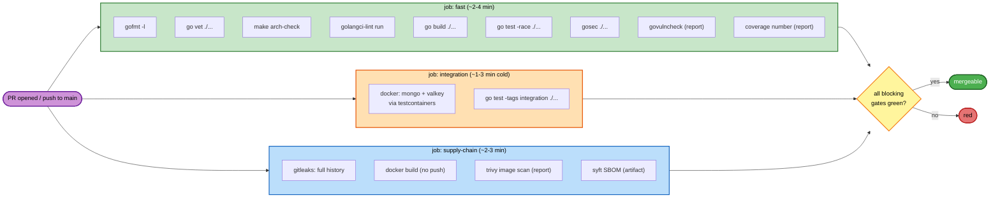

# Infrastructure Design — unit `ci`

**Date**: 2026-07-13
**Requirements**: `inception/requirements/requirements.md` §12 (r6)
**Answers**: plan Q1-Q10 → Q1=A · Q2=A · Q3=A · Q4=A · Q5=A+C · Q6=A · Q7=A · Q8=A · Q9=A · Q10=A
**Blocking findings**: 0

> For this unit, *infrastructure* is the pipeline. Runtime infrastructure (Mongo, Valkey, k8s, proxy) is untouched — `construction/shared-infrastructure.md` is **not modified by this increment**.

---

## 1. The one sentence this design serves

> **A change that reintroduces the Valkey `Drain` bug must turn the pipeline red.**

The `Drain` bug made `StopScan` not stop a scan. It shipped in two consecutive increments while Build&Test was green both times, because nothing ran the durable backends. Every decision below is measured against that sentence. A pipeline that compiles and unit-tests is not a pipeline; it is a compiler with a green badge.

---

## 2. Job graph (S1) — Q6=A

Three jobs, **all starting at once**. No job waits on another. CI-NFR-03 forbids putting the fast gates behind the slow ones.



### Text alternative

```
trigger: pull_request (any branch -> main)  |  push (main)

  job "fast"          (parallel, no deps)
      gofmt -l  ->  go vet  ->  make arch-check  ->  golangci-lint
      go build  ->  go test -race ./...
      gosec  ->  govulncheck (report only)  ->  coverage (report only)

  job "integration"   (parallel, no deps)
      go test -tags integration -timeout 10m ./...
      (testcontainers starts real Mongo + Valkey)

  job "supply-chain"  (parallel, no deps)
      gitleaks detect (full history)
      docker build (no push)  ->  trivy image scan (report)  ->  syft SBOM (artifact)

  merge allowed only when every BLOCKING gate is green (see 5)
```

**Why `gitleaks` sits in supply-chain rather than fast**: it needs `fetch-depth: 0` (full history), which is the slowest checkout. Keeping it out of `fast` protects the fast job's latency budget.

**Concurrency (Q7=A)**: `concurrency: group=<workflow>-<ref>, cancel-in-progress: true`. A new commit on a PR cancels the previous run.

---

## 3. Toolchain strategy (S3) — Q5=A(+C)

| Where | Mechanism | Pinned to |
|---|---|---|
| `go.mod` | `go 1.26.5` directive | 1.26.5 |
| CI runner | `actions/setup-go` with `go-version-file: go.mod` | reads go.mod — **cannot drift** |
| Dockerfile build stage | `golang:1.26.5@sha256:…` | 1.26.5, digest-pinned |
| Developer machine | Verified installed: `/usr/local/go` = go1.26.5 | 1.26.5 |

**The point of `go-version-file: go.mod`**: it makes CI-NFR-02 *structurally* true rather than a promise. There is no second place to update, so CI and `go.mod` cannot disagree.

**`GOTOOLCHAIN` behaviour**: with `go 1.26.5` in `go.mod`, a developer on an older Go auto-downloads 1.26.5 (`GOTOOLCHAIN=auto`, the default). Under `GOTOOLCHAIN=local` on an older Go, the build **fails loudly** with a version-mismatch error rather than silently compiling against an old stdlib. That is the correct failure — a silent old-stdlib build is how GO-2026-5856 stayed alive.

**Cache (Q5=A+C)**: `actions/setup-go` built-in cache, keyed on `go.sum`, on **pull requests**. On **push to `main`**, cache is disabled (`cache: false`) → a fully clean build. This gives fast PR feedback while guaranteeing that what lands on `main` was built from nothing, satisfying CI-NFR-04 where it matters. A poisoned or stale cache cannot silently become the thing we shipped.

---

## 4. Version pinning (S2, S4) — CI-NFR-01, SECURITY-10/13

**Design choice: minimize third-party Actions.** Only two Actions are used, both first-party, both pinned by commit SHA. Every other tool runs either as a Go module at an exact version (integrity guaranteed by the Go module proxy + `go.sum` semantics) or as a container pinned by digest. This shrinks the action supply-chain surface from ~7 third-party actions to 0.

### Actions (pinned by commit SHA)

| Action | Version | Commit SHA |
|---|---|---|
| `actions/checkout` | v5 | `93cb6efe18208431cddfb8368fd83d5badbf9bfd` |
| `actions/setup-go` | v6 | `924ae3a1cded613372ab5595356fb5720e22ba16` |

### Go-module tools (pinned by module version)

| Tool | Version | Invocation |
|---|---|---|
| golangci-lint | **v2.6.0** | `go run github.com/golangci/golangci-lint/v2/cmd/golangci-lint@v2.6.0` |
| gosec | **v2.22.9** | `go run github.com/securego/gosec/v2/cmd/gosec@v2.22.9` |
| govulncheck | **v1.6.0** | `go run golang.org/x/vuln/cmd/govulncheck@v1.6.0` |

> **Defect found while designing**: the current `Makefile` `vuln:` target uses **`govulncheck@latest`** — a floating version, which **violates CI-NFR-01/SECURITY-10 ("no `latest`, pinned tool versions")** in the very target meant to enforce supply-chain hygiene. Pinned to v1.6.0.

### Containers (pinned by digest)

| Image | Tag | Digest |
|---|---|---|
| Go build base | `golang:1.26.5` | `sha256:079e59808d2d252516e27e3f3a9c003740dee7f75e55aa71528766d52bcfc16a` |
| Runtime base | `gcr.io/distroless/static-debian12:nonroot` | `sha256:b7bb25d9f7c31d2bdd1982feb4dafcaf137703c7075dbe2febb41c24212b946f` |
| gitleaks | `zricethezav/gitleaks:v8.21.2` | `sha256:0e99e8821643ea5b235718642b93bb32486af9c8162c8b8731f7cbdc951a7f46` |
| trivy | `aquasec/trivy:0.72.0` | `sha256:cffe3f5161a47a6823fbd23d985795b3ed72a4c806da4c4df16266c02accdd6f` |
| syft | `anchore/syft:v1.33.0` | `sha256:f94e5d9fce1f2278491a8e3a63bd5f6ddb81fdfdbb8bf7a1637565c1d5344357` |

All digests were **resolved from the live registries during this design**, not copied from documentation.

### Digest refresh policy (Q9=A)

`.github/dependabot.yml` enables Dependabot for `docker` and `github-actions` ecosystems, weekly. **This is the necessary counterweight to pinning**: a digest-pinned base image never picks up a security patch on its own. Without an updater, "pinned" degrades into "abandoned" — and with no nightly schedule (C1=D), nothing else would ever tell us. Dependabot opens a PR; that PR runs the full pipeline; a human merges.

---

## 5. Blocking vs reporting matrix (S5)

| Gate | Job | Blocking? | Source | Note |
|---|---|---|---|---|
| `gofmt -l` (empty output) | fast | **BLOCK** | CI-FR-02 | |
| `go vet ./...` | fast | **BLOCK** | CI-FR-02 | |
| `make arch-check` | fast | **BLOCK** | CI-FR-02 | NFR-02 one-way dependency |
| `golangci-lint run` | fast | **BLOCK** | D-8 | depguard also enforces NFR-02 (belt + braces) |
| `go build ./...` | fast | **BLOCK** | CI-FR-02 | |
| `go test -race ./...` | fast | **BLOCK** | CI-FR-02 | includes PBT (Q13=A) |
| `gosec ./...` | fast | **BLOCK** | D-11 | |
| **`go test -tags integration ./...`** | **integration** | **BLOCK** | **CI-FR-03** | **the load-bearing gate** |
| `gitleaks detect` (full history) | supply-chain | **BLOCK** | D-10 | |
| `docker build` (no push) | supply-chain | **BLOCK** | CI-FR-04 | a broken Dockerfile is a broken release |
| `govulncheck` | fast | *report* | D-6 (C1=D) | |
| `trivy image` (HIGH/CRITICAL) | supply-chain | *report* | D-12, Q10=A | |
| coverage % | fast | *report* | D-7 | |
| `syft` SBOM | supply-chain | *report* (artifact) | CI-FR-07 | |

Reporting gates run with `continue-on-error: true` and always upload their output. **The distinction is deliberate**: a gate that blocks must be one whose red state is *actionable by the author of the PR*. A CVE published in the Go stdlib this morning is not actionable by the person fixing a typo — blocking on it would train people to ignore red.

---

## 6. Integration-job timeouts (S1) — Q8=A, corrected by measurement

**Measured**: the full integration suite (`go test -tags integration ./...`, real Mongo + Valkey via testcontainers) completes locally in **14.9 seconds**, FAIL 0. The prior documentation's "수 분~수십 분" estimate was wrong. On a cold CI runner, add image pulls for Mongo and Valkey — expect **1-3 minutes**.

Q8=A asked for a **25-minute job timeout, shorter than Go's 30-minute `-timeout`**. Taken literally, that combination has a flaw: **the job would be killed at 25 min before Go's `-timeout` fired at 30, so a hang would never produce a goroutine dump** — and we would be told *that* it hung, never *where*. The last hang cost 25 minutes and was only diagnosed by reading the code.

**Design (honours the intent, fixes the ordering)**:

| Layer | Value | Role |
|---|---|---|
| `go test -timeout` | **10m** | Fires **first** on a hang → panics with a **full goroutine dump**. 40× headroom over the 15 s measured runtime. |
| GitHub job `timeout-minutes` | **25** | Backstop, per Q8=A. Only reached if Go itself is wedged. |

So a hang is red in ~10 minutes **with a stack trace**, and the 25-minute job cap remains as the outer bound the user asked for. `make test-integration` changes `-timeout 30m` → `-timeout 10m` accordingly.

---

## 7. Secret handling (S7) — Q1=A

### 7.1 What was found

`gitleaks detect` over the full history returns **1 finding**: `CHILLER_EVIDENCE_KEY` in `deploy/compose/docker-compose.yml:43`, committed in `a3ad705`. The value decodes to `dev-only-key-do-not-use-in-prd!!`. Alongside it, `CHILLER_TOKEN: "dev-token-change-me"` — a hardcoded credential literal that gitleaks does *not* flag (entropy too low), but which **SECURITY-12 forbids just as plainly**: *"No passwords, API keys, or secrets in source code or IaC templates."* A compose file is an IaC template.

Neither is a real credential. Both are, in form, exactly the thing the rule prohibits. The gate cannot distinguish "harmless placeholder" from "production key" — and it must not be taught to, because that is precisely the judgment that leaks keys.

### 7.2 Design (Q1=A)

1. **Remove both literals from `deploy/compose/docker-compose.yml`.** Compose reads them from the environment: `CHILLER_EVIDENCE_KEY: ${CHILLER_EVIDENCE_KEY:?set it in .env}`, same for `CHILLER_TOKEN`. The `:?` form fails loudly with a message rather than silently starting with an empty key.
2. **Ship `deploy/compose/.env.example`** with the dev placeholder values and a comment; add `deploy/compose/.env` to `.gitignore`. Developer experience is preserved — `cp .env.example .env` and compose works.
3. **Rewrite history** to purge the value from commit `a3ad705`, using `git filter-repo`. **This is only free because the repo has never been pushed** (11 commits, remote created but empty). After the first push it would require a force-push and coordination.
4. **No `.gitleaksignore`.** The allowlist stays empty, so the gate has no exemptions to hide behind.

**Consequence to state plainly**: history rewrite changes every commit SHA. The `worktree-probe-stub-honesty` worktree and any local clone must be re-based or re-cloned. Since nothing has been pushed and no one else has the repo, the blast radius is this machine.

**Why not simply allowlist (option B/C)**: an allowlist entry is a permanent statement that "this particular secret in our history is fine." It is correct here, and it would also be correct-looking on the day someone allowlists a real key. The empty-allowlist invariant is worth more than the 10 minutes the rewrite costs, *at the one moment in this project's life when it costs 10 minutes.*

---

## 8. HTTP server hardening (S8) — Q2=A

| Server | File | Change |
|---|---|---|
| Auth forward-proxy | `internal/platform/proxy/authproxy.go:46` | `ReadHeaderTimeout: 10 * time.Second` |
| ScanAPI | `cmd/chiller/main.go:239` | `ReadHeaderTimeout: 10 * time.Second` |

**Only `ReadHeaderTimeout`.** Slowloris works by dribbling request *headers*; bounding header-read time defeats it. That is the entire content of gosec G112.

**Why not the full timeout set** (deliberately rejected): `WriteTimeout` on the **forward proxy** would cap how long a relayed response may take to write. The proxy's job is relaying arbitrary upstream responses — including large JS bundles, which the PS-009 signature checks specifically want. A `WriteTimeout` would truncate exactly the payloads this scanner exists to read, and it would do so *intermittently, under load*, which is the worst possible failure mode. The 10 s bound is on **header read**, not on the response, so no legitimate payload is at risk.

**Consistency with SR-8**: the scan-side per-request deadline is 20 s (`internal/scan/fetch/fetch.go:19`). 10 s to send request headers is generous by comparison — a client that cannot finish its header block in 10 s is not a client we serve.

---

## 9. gosec dispositions (S9)

| Finding | Sites | Disposition | Rationale |
|---|---|---|---|
| **G112** ×2 | `authproxy.go`, `main.go` | **Fix** (§8) | Real defect. |
| **G304** ×3 (Q3=A) | `findings/config/{spec,severity,mapping}.go` | **`#nosec G304` + written reason** | The path is an operator-supplied config location (a CLI flag), inside the trust boundary — not user input. Adding a prefix check would break the legitimate case of an operator keeping configs elsewhere, in exchange for no real defence. The annotation records *why*, in the source, where the next reader will see it. |
| **G115** ×1 (Q4=A) | `findings/store/retry.go:86` | **Fix: guard inside the function** — `if attempt < 1 { attempt = 1 }` | Not currently a bug: the only caller guards `attempt > 0`. But the safety lives in the *caller*, and `uint(2*(attempt-1))` with `attempt == 0` yields a huge shift → backoff silently becomes **0** → retry storm against a failing Mongo. Moving the guard into the function makes the function safe on its own terms. |
| errcheck ×7, staticcheck ×1 | various | **Fix** | Trivial. |

---

## 10. Makefile ↔ workflow contract (S10)

**The workflow invokes `make` targets, not raw commands.** Every gate a developer can run locally is the *same command* CI runs. The drift this prevents is the failure mode that produced X-1: `make lint` existed, referenced `.golangci.yml`, and **had never once loaded it** — because nothing ever ran it.

Targets after this increment:

| Target | What it runs | Used by |
|---|---|---|
| `build` | `go build ./...` | fast |
| `test` | `go test -race ./...` (race added) | fast |
| `test-integration` | `go test -tags integration -timeout 10m ./...` | integration |
| `lint` | golangci-lint **v2.6.0** via `go run` (no local install needed) | fast |
| `arch-check` | import guard | fast |
| `gosec` | gosec v2.22.9 via `go run` | fast |
| `vuln` | govulncheck **v1.6.0** (was `@latest` — pinned) | fast (report) |
| `sbom` | syft, digest-pinned container (was: bare `syft` binary) | supply-chain |
| `secrets` | gitleaks, digest-pinned container, full history | supply-chain |
| `cover` | coverage % | fast (report) |

`lint`, `gosec`, `vuln`, `sbom`, `secrets` no longer require any tool to be pre-installed — which is why the developer machine could have a `.golangci.yml` that never ran. CI-NFR-04 (clean-runner reproducibility) now holds for developers too.

---

## 11. Verification protocol (S11) — what can and cannot be proven

R-3 is **closed**: a remote now exists (`github.com/hongsam14/Service-Passive-Scanner`, private, default branch `main`). The pipeline can therefore be *actually observed*, not merely asserted.

| Claim | How it gets proven | Status |
|---|---|---|
| Every gate passes | Run each `make` target locally with the pinned versions | Build and Test stage |
| The workflow YAML is valid and the jobs run | **Push and watch the Actions run** (`gh run watch`) | Build and Test stage — *this is now possible* |
| The pipeline catches the bug it exists to catch | **Reintroduce the Valkey `Drain` bug on a scratch branch, confirm the pipeline turns red, revert** | Build and Test stage — the only test of the success criterion that means anything |

The last row is not ceremony. The entire justification for CI-FR-03 is a bug that two green Build&Test runs failed to catch. Asserting that the new pipeline would have caught it, without demonstrating it, would repeat the exact error this increment was created to fix.

---

## 12. Extension compliance summary

| Extension | Rule | Status | Rationale |
|---|---|---|---|
| **security-baseline** | SECURITY-10 (supply chain) | ✅ Compliant | Vulnerability scanner configured in CI (rule requires *configured*, not *blocking* — C1=D is therefore compliant). All tool versions pinned; **found and fixed `govulncheck@latest` in the Makefile, which violated this rule inside the target meant to enforce it**. SBOM produced. Base images digest-pinned. Dependabot prevents pinning from decaying into abandonment. |
| | SECURITY-12 (credentials) | ✅ Compliant | Two hardcoded credential literals removed from an IaC template (§7); pipeline requires **zero repository secrets** (CI-NFR-05) — a pipeline with no credentials cannot leak any; gitleaks blocking, with an **empty allowlist**. |
| | SECURITY-13 (integrity) | ✅ Compliant | Actions pinned by commit SHA, images by digest, Go tools by module version. Go 1.26.5 tarball was **SHA256-verified against go.dev before install**. Pipeline-definition review = branch protection, an operator action (§13). |
| | SECURITY-09 (hardening) | ✅ Compliant | G112 Slowloris exposure fixed on both HTTP servers (§8) — a runtime defect this increment surfaced and closed. |
| | SECURITY-01..08, 11, 14, 15 | N/A | No runtime surface added; no data store, network, authz, or logging change. |
| **resiliency-baseline** | RESILIENCY-04 (automated deployment + rollback) | ✅ Compliant (CI half) | The rule's mandatory question is answered: **GitHub Actions**. Deployment automation is explicitly out of scope by user decision (Q12=A); rollback mechanism was already chosen in the platform increment (rolling + version-pinned). The rule defers these to the user; the user chose. Not a blocking finding. |
| | RESILIENCY-14 (resiliency testing) | ✅ Improved | The durable-backend contract suite now runs on **every PR** — the first time any resiliency-relevant test runs automatically at all. |
| | Others | N/A | No topology, DR, or capacity change. |
| **property-based-testing** | PBT-08 (PBT in CI, seed logging) | ✅ Compliant | PBT runs inside `go test -race ./...`, now a blocking gate. **This increment is what puts PBT into CI for the first time.** |
| | PBT-01..07, 09, 10 | N/A | No new business logic, no new properties. |

**Blocking findings: 0.**

---

## 13. Operator actions (outside this repo)

These cannot be done by committing a file and are **not** claimed as done:

1. **Branch protection on `main`** — require the `fast`, `integration`, and `supply-chain` checks; require PR review. Without this, the gates are advisory and anyone can push straight to `main`. **SECURITY-13 ("separate duties between code authors and deployment approvers") depends on it.**
2. **Enable Dependabot** in repo settings (the `.github/dependabot.yml` file is necessary but the feature must also be on for private repos).

## 14. Known limitations (carried, not hidden)

- **No nightly (C1=D)** → a CVE published during a quiet period is not detected until someone opens a PR. Accepted consequence, recorded.
- **`govulncheck` and `trivy` are non-blocking** → a vulnerable dependency can merge. Mitigated only by someone reading the report.
- **No image push, no signing** → `cosign` and registry publication remain deferred to a future increment.
- **History rewrite invalidates existing local clones/worktrees** (§7.2).
