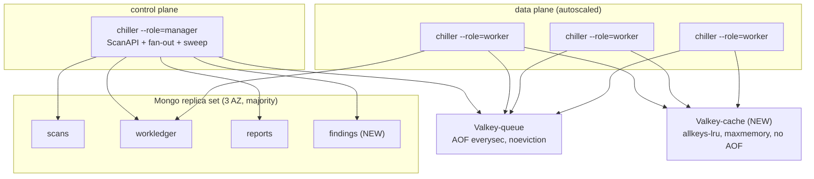

# Deployment Architecture — persistence 증분

**Stage**: CONSTRUCTION → Infrastructure Design
**Date**: 2026-07-13
**변경 요지**: 기존 토폴로지(단일 이미지 role-flag · 단일 리전 멀티 AZ · rolling 배포)는 **그대로**.
이번 증분은 **백엔드 두 개의 배선**만 바꾼다 — Mongo에 `findings` 컬렉션 추가(**인스턴스 공유**),
**Valkey-cache 인스턴스 신규 추가**(큐와 분리).

---

## 1. 토폴로지 (변경 후)

**텍스트 대안 (다이어그램과 동일 내용)**

- **manager** (control plane): ScanAPI · fan-out · lease sweep · finalize. Mongo의 `scans`/`workledger`/`reports`/`findings`와
  Valkey-queue에 접근한다. finalize에서 `findings` 쓰기 + 캐시 `WipeScan`을 수행한다.
- **worker** (data plane, 오토스케일): Valkey-queue에서 작업을 꺼내고, `workledger`에 CAS 청구하며, **Valkey-cache**에
  응답을 넣고/꺼낸다. worker는 `findings` 컬렉션에 **직접 쓰지 않는다** (finding은 outcome에 실려 원장을 통해 manager로 모인다).
- **Mongo**: 인스턴스 하나(3노드 replica set), 컬렉션 4개. `findings`가 이번에 추가된다.
- **Valkey-queue**: 기존. 내구성 우선(AOF, `noeviction`).
- **Valkey-cache**: **신규**. 휘발성 우선(`allkeys-lru`, `maxmemory`, AOF 불필요).

---

## 2. 왜 Valkey를 두 인스턴스로 나누는가 (Q11=A)

`shared-infrastructure.md` §2가 이미 확정한 결정이며, 근거는 **정책의 정면 충돌**이다:

| | Valkey-queue | Valkey-cache |
|---|---|---|
| eviction | **`noeviction`** — 작업 항목을 절대 버리면 안 됨 | **`allkeys-lru`** — 메모리 압박 시 버려도 됨 (재fetch로 복구) |
| 지속성 | AOF `everysec` (재시작 후 잔존) | 없음 (휘발성) |
| 수명 | 스캔 진행 동안 | TTL 6h + 스캔 종료 시 wipe |

**한 인스턴스에 합치면**: 캐시의 LRU eviction이 **큐 항목을 evict**하거나(작업 유실), 큐의 `noeviction`이
**캐시 쓰기를 OOM 에러로 막는다**. 둘 다 조용한 오동작이다. → 분리가 유일한 정답.

**비용**: Valkey 인스턴스 1대 추가. 캐시는 **유실 허용**이므로 복제 없이 단일 노드로 운영 가능(리소스 절감),
장애 시 fail-open(§Q8)으로 스캔은 계속된다.

---

## 3. 설정 / 시크릿 (SECURITY-09/12)

| 변수 | 용도 | 신규 |
|---|---|---|
| `CHILLER_MONGO_URI` | Mongo 접속 (**기존 재사용** — findings도 같은 인스턴스) | |
| `CHILLER_VALKEY_ADDR` / `..._PASSWORD` | Valkey-**queue** | |
| `CHILLER_VALKEY_CACHE_ADDR` | Valkey-**cache** | ✅ |
| `CHILLER_VALKEY_CACHE_PASSWORD` | Valkey-**cache** 인증 | ✅ |
| `CHILLER_EVIDENCE_KEY` | AES-256 키 (base64 32B) — evidence + 캐시 값 암호화 | ✅ |
| `CHILLER_TOKEN` | ScanAPI Bearer | |

- 전부 **K8s Secret / 볼트 주입**. 소스·이미지 하드코딩 금지. `secret.example.yaml`은 템플릿일 뿐.
- **`CHILLER_EVIDENCE_KEY`가 없는데 `--findings-store=mongo` 또는 `--cache=valkey`면 기동 실패**(fail-closed).
- ACL(SECURITY-06): Mongo 서비스 계정은 `chiller` DB의 자기 컬렉션만 readWrite. Valkey는 키 접두사 제한 ACL
  (`chiller:cache:*` / `chiller:queue:*`).

---

## 4. 배포 자산 변경

| 자산 | 변경 |
|---|---|
| `deploy/compose/docker-compose.yml` | `valkey-cache` 서비스 추가 (`--maxmemory 512mb --maxmemory-policy allkeys-lru`, AOF off). 앱 env에 cache 주소·키 추가 |
| `deploy/k8s/` | `valkey-cache` Deployment/Service (또는 StatefulSet 불필요 — 휘발성) + ConfigMap(maxmemory/policy) + Secret 키 추가 |
| `deploy/k8s/secret.example.yaml` | `CHILLER_VALKEY_CACHE_*`, `CHILLER_EVIDENCE_KEY` 템플릿 항목 추가 |
| Mongo | **인프라 변경 없음** — 컬렉션·인덱스는 앱이 기동 시 보장(`EnsureIndexes`, 기존 패턴) |
| `Makefile` | `test-integration`이 Valkey-cache 컨테이너도 띄우도록 (testcontainers가 코드에서 처리 → Makefile 변경 최소) |

---

## 5. 장애 격리 (RESILIENCY-07)

| 백엔드 다운 | 결과 |
|---|---|
| **Valkey-cache** | **fail-open** — 캐시 miss로 처리, 재fetch(rate limiter 상한 유지). 스캔은 느려질 뿐 완주. 에러는 `cache_errors_total`로 노출. **스캔 실패 없음** |
| **Mongo (findings)** | finalize의 `SaveFindings` 재시도(3회 백오프) → 소진 시 `scan=failed`. 결과를 조용히 버리지 않음 |
| **Valkey-queue** | (기존) 작업 배분 중단 — 이번 증분과 무관 |
| **Mongo (scans/ledger)** | (기존) 오케스트레이션 중단 — 이번 증분과 무관 |

**격리 원칙**: 캐시(최적화 계층)의 장애는 **절대 스캔을 죽이지 않는다**. 저장소(정확성 계층)의 장애는 **조용히 넘어가지 않는다**.

---

## 6. 공유 Mongo 트레이드오프 (RESILIENCY-10 — 문서화 의무)

`findings` 쓰기가 오케스트레이션(`scans`/`workledger`의 CAS)과 **같은 replica set을 공유**한다.

- **위험**: 대형 스캔의 findings 대량 쓰기가 CAS p95를 악화시킬 수 있다.
- **완화**: findings 쓰기는 **finalize 시점 1회 bulk**(스캔당 한 번)이고, CAS는 item 단위로 상시 발생 → 시간축이 대체로 분리된다.
- **승격 경로**: 관측(§5.1의 `findings_save_duration_ms` + CAS 지연)에서 상관이 확인되면, **인터페이스 무변경**으로
  `findings`를 전용 replica set으로 분리한다(접속 문자열만 교체 — `--findings-mongo-uri` 추가). shared-infrastructure §3에 이미 예고된 경로.

---

## 7. 배포 / 롤백

- **배포**: rolling (기존 정책). 새 백엔드는 **기본 off**(`mem`)이므로, 이미지 배포와 백엔드 활성화를 **분리**할 수 있다.
- **활성화 순서**: ① Valkey-cache 프로비저닝 + 시크릿 주입 → ② `--cache=valkey`로 워커 롤아웃(캐시는 유실 허용이라 리스크 낮음)
  → ③ `--findings-store=mongo`로 매니저 롤아웃 (findings 스키마가 여기서 처음 쓰임).
- **롤백**: 플래그를 `mem`으로 되돌리고 이전 버전 이미지로 rolling back. `findings` 컬렉션은 **남겨 둔다**(파괴적 롤백 없음).
- **스키마 파괴적 변경 주의**: `Severity` int→string, `FrameworkLabels` []int→[]FindingKey 는 **기존 `reports` 문서와 비호환**이다.
  프로덕션 데이터가 없으므로 마이그레이션은 불필요하지만, **개발/스테이징 DB는 배포 전에 drop**해야 한다 (배포 노트).

---

## 8. 이번 증분에서 결정하지 않은 것 (범위 밖)

- OTel 익스포터 (infra-plan #3) — §5의 카운터를 다음 증분이 그대로 읽어간다.
- OIDC/mTLS Authorizer (infra-plan #4).
- Mongo 백업/복원 정책, KEDA 오토스케일 — `operations/production-readiness.md`의 "권장(non-blocking)" 항목 그대로.
