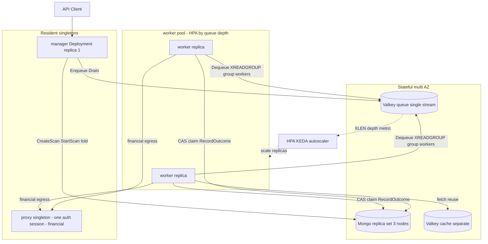

# Deployment Architecture — unit: platform (U1)

**Locked**: Q1=C(compose+K8s) · Q2=B(큐 깊이 오토스케일 상주 worker 풀) · Q3=A(single manager) · C1=A(상주 컨트롤/세션 + worker 풀) · Q11=C(single-region multi-AZ, rolling, version-pinned rollback) · Q12=B(RPO≈0, RTO minutes).

> **정정 1 (2026-07-11, 사용자 피드백)**: proxy는 **스캔당이 아니라 싱글턴**이다. proxy가 존재하는 이유가 바로 "**단일** 인증 세션"이므로, proxy를 스캔 수만큼 늘리면 그 존재 이유와 모순된다. 원설계(domain-entities.md §E-5 "worker 다수가 **한 proxy**를 가리켜 단일 세션 불변식 유지하며 수평 확장")·MVP(`--storage-state` 단일 파일)와 일치. → **proxy는 상주 싱글턴**.
>
> **정정 2 (2026-07-11, 사용자 피드백)**: worker는 **스캔당 Job(Q2=C)이 아니라 큐 깊이 기반 오토스케일 상주 풀(Q2=B)**. proxy 싱글턴화로 worker가 특정 스캔에 묶일 이유가 사라졌고, Valkey Streams **consumer group**이 곧 "안정적 소비자 풀의 경쟁 소비" 모델이라 상주 풀과 자연 정합. 큐도 **단일 공유 스트림**으로 통일(스캔당 스트림 폐기). manager는 이제 worker Job을 launch하지 않고 **Enqueue만** → K8s Job API 의존 제거.

---

## 1. 토폴로지 (C1=A; proxy 싱글턴 · worker 오토스케일 풀 정정 반영)

3계층: **상주 컨트롤/세션**(manager 단일 + proxy 싱글턴) · **worker 오토스케일 풀**(Q2=B, 큐 깊이 트리거) · **상주 stateful**(멀티 AZ). 동일 이미지, `--role` 플래그로 역할 결정(Q1=C).

### Mermaid (검증됨: 노드 ID 영숫자, 라벨 특수문자 없음)



### 텍스트 대안 (항상 포함)

```
Resident singletons (상주):
  manager (Deployment, replica=1, Q3=A)
    - API endpoints + ScanState FSM + fold/report 조립
    - Mongo(scans/workledger/reports) 읽기·쓰기, Valkey 단일 스트림 Enqueue + drained-set Drain
    - worker Job을 launch하지 않음 — 큐에 Enqueue만 하면 상주 풀이 가져감
  proxy (싱글턴, --role=proxy, 금융 모드에서만 구동)
    - 단일 인증 세션(storageState 1개) 보유 = 단일 세션 불변식
    - 금융 스캔의 모든 worker egress를 이 한 세션으로 주입·포워딩
    - 스캔 수와 무관하게 1개.

worker 풀 (상주, 오토스케일 — Q2=B):
  worker Deployment (replica N, HPA/KEDA가 큐 깊이 XLEN/컨슈머 lag로 N 증감)
    - consumer group `workers`의 컨슈머(=각 replica)가 단일 공유 스트림에서 경쟁 XREADGROUP
    - 원장 CAS claim(pending→inflight) → 체커 실행 → RecordOutcome → XACK
    - drained 스캔 항목은 claim 없이 XACK+skip(lazy drain)
    - 금융 모드면 egress를 상주 proxy 싱글턴으로 라우팅
    - 내부 reaper가 XAUTOCLAIM으로 죽은 replica의 pending 회수(C2=A)

Stateful (멀티 AZ, 상주):
  Mongo replica set (3 노드/3 AZ) : 원장·스캔·보고서, write-concern majority
  Valkey (queue, 단일 공유 스트림) : chiller:queue:stream + group workers (내구성, AOF, noeviction)
  Valkey (cache, 분리 — Q9=C)     : ResponseCache (휘발성; 이번 스코프 밖이나 배치는 선반영)

흐름: Client → manager.CreateScan → StartScan(fan-out: Enqueue만)
      → worker 풀.Dequeue(공유 스트림 경쟁) → CAS claim → check(금융이면 egress=proxy 싱글턴)
      → RecordOutcome → XACK → manager.fold → SaveReport
```

### 싱글턴 proxy의 귀결 (단일 세션 불변식의 직접 결과)
- proxy가 **하나의 storageState**에 묶이므로, chiller 한 배포는 **한 번에 하나의 인증 세션**만 보유한다.
- 따라서 **서로 다른 인증 대상(다른 자격증명)에 대한 금융 스캔은 동시에 돌 수 없다** — 한 세션을 공유하면 신원이 뒤섞이기 때문. 동시 금융 스캔은 (a) 같은 세션 대상이면 worker 풀 확장으로 처리, (b) 다른 세션 대상이면 **직렬화하거나 별도 배포**로 분리한다.
- 비금융 스캔은 proxy를 거치지 않으므로 이 제약과 무관(자유롭게 동시 실행).
- 이 제약은 원래의 "단일 세션 불변식"을 배포 수준에서 정직하게 표현한 것이다(설계 결함이 아니라 의도된 경계).

---

## 2. 배포 단위 & 이미지 (Q1=C)

| 산출물 | 용도 | 내용 |
|---|---|---|
| 단일 컨테이너 이미지 `chiller` | 모든 역할 | `cmd/chiller` 바이너리. `--role=manager|worker|proxy|all`로 분기. base·태그 digest 핀(SECURITY-10/13) |
| `deploy/compose/docker-compose.yml` | 로컬 개발·통합 테스트 | chiller(all) + Mongo(단일 노드, dev) + Valkey. testcontainers와 별개로 손수 기동용 |
| `deploy/k8s/` 매니페스트 | 운영 | manager Deployment(replica 1) · **proxy Deployment(replica 1, 싱글턴, 금융 시)** · **worker Deployment + HPA/KEDA(큐 깊이 트리거, min/max replica)** · Mongo StatefulSet(3) · Valkey(큐/캐시) · Secret(접속문자열/storageState/토큰) · NetworkPolicy |

> compose와 K8s는 **동일 이미지**, 배선(주입 플래그·엔드포인트)만 다름. compose에서는 `--role=all`(인프로세스 워커 풀)로 단순화; K8s 운영에서는 manager/proxy/worker Deployment 분리 + worker에 오토스케일러 부착.

---

## 3. 장애 격리 / 정적 안정성 (RESILIENCY-08)

| 계층 | 다중화 | 존 장애 시 |
|---|---|---|
| Mongo | 3 노드 / 3 AZ replica set | 1 AZ 소실 → 남은 2 노드로 자동 election, 계속 서비스 |
| Valkey(큐) | primary+replica 멀티 AZ | 페일오버; 큐 유실은 원장이 SoT라 RPO 무영향, 진행 배달은 재개로 복구 |
| worker 풀 | 상주 Deployment, replica N 오토스케일, 임의 AZ 스케줄 | replica 소실 → 남은 replica가 계속 소비, 죽은 replica의 pending은 `XAUTOCLAIM`(C2=A)이 회수, 원장 CAS로 중복 방지. HPA가 부하 따라 재보충 |
| proxy (싱글턴) | **1개 (금융 세션 전체의 SPOF)** | 소실 시 진행 중 금융 스캔 전부 일시 중단 → 재기동으로 세션 복원 후 재개. 비금융 스캔 무영향. 단일 세션 불변식의 대가로 수용된 SPOF |
| **manager** | **단일 replica (Q3=A)** | **컨트롤 플레인 SPOF (아래 트레이드오프)** |

**manager 단일 인스턴스 트레이드오프 (RESILIENCY-02, 사용자 명시 선택 Q3=A)**:
- API(스캔 제출/조회)가 manager 재기동 동안 잠시 불가 — **RTO = pod 재스케줄 시간(수 분, Q12=B와 일치)**.
- **진행 중 스캔은 무영향**: 상태가 Mongo 원장 + Valkey 스트림에 내구 저장(Q12=B, RPO≈0). manager 재기동 시 `ResumeScan`으로 이어받음.
- 정적 안정성: 데이터 플레인·상태 계층은 멀티 AZ. 컨트롤 플레인은 K8s가 건강한 노드/AZ로 **재스케줄**(단일 active). 배치 성격 스캐너라 무중단 컨트롤 플레인 불요 → **정당화된 편차**(RESILIENCY-08, 예외 문서화).
- 비즈니스 영향(RESILIENCY-01): manager 다운타임 = "신규 스캔 제출 지연"뿐, 실행 중/완료 결과 손실 없음.

---

## 4. 배포 & 롤백 (Q11=C, RESILIENCY-03/04)

미해결 충돌 2건을 Q11=C로 확정 (§5 참조). 요구사항 라운드2의 canary(Q5r2)·blue/green(Q6r2)는 **폐기**(정정).

- **배포 방식 = rolling** (RESILIENCY-04 배포=B): manager·proxy는 replica 1 싱글턴이라 사실상 recreate(짧은 다운타임 허용, §3 트레이드오프; proxy 재기동 시 세션 재복원). **worker 풀은 진짜 rolling** — replica를 순차 교체, 교체 중 in-flight item은 `XAUTOCLAIM` 회수 + 원장 CAS로 안전(무중단, 배치 스캐너).
- **롤백 = 버전 고정 재배포** (RESILIENCY-04 롤백=A): 이전 이미지 digest로 매니페스트 재적용. DB 스키마는 enum 문자열화(Q4=A)로 하위호환이라 대개 스키마 역전 불필요; 불가피 시 `schemaVersion` 필드로 분기.
- **변경관리**(RESILIENCY-03, Q3r2=B): 조직 프로세스 부재 → 경량 제안 — 변경 레코드(무엇을/언제/누가) + 승인 게이트 + 롤백 노트. Operations로 이월.
- **CI/CD**(RESILIENCY-04, Q4r2=B): 파이프라인 제안 — build → `go vet`/`gofmt`/`make arch-check` → 단위+계약(mem) → `govulncheck` → 통합(testcontainers, Q10=A, 별도 잡) → 이미지 빌드(digest 핀) → SBOM. **AWS 의존 없음**(요구사항 라운드2 Q4=B).

---

## 5. 미해결 설계 질문 해소 기록 (P1-5)

`aidlc-state.md §Open design questions`의 이월 항목을 여기서 확정:

| 이월 항목 | 이전 충돌 | **확정(이 스테이지)** |
|---|---|---|
| Warm Standby(Q2r2=C) vs no-multi-region(Q7r2=X) | 크로스리전 함의 충돌 | **단일 리전 · 멀티 AZ** (Q11=C). Warm Standby를 "리전 내 상시 가동 + 멀티 AZ"로 재해석, 크로스리전 폐기(Q7r2=X 존중). Mongo 3 AZ / Valkey 멀티 AZ가 "warm" 상시성 제공 |
| canary(Q5r2=C) vs blue/green(Q6r2=C) | 배포 방식 충돌 | **rolling + 버전 고정 롤백** (Q11=C). 둘 다 폐기 — 배치 스캐너라 트래픽 전환/무중단 컷오버 불요 |
| NFR 수치 경계 A-4 (처리량/지속시간) | 미정 | **RPO≈0 · RTO 수 분**(Q12=B). 처리량은 **worker 풀 replica 수로 선형 확장**(Q2=B, HPA가 큐 깊이로 자동 조절); p95 스캔 지속시간 SLO는 fleet 확정 후 `build-and-test/performance-test-instructions.md`의 스케일링 곡선법으로 측정(수치는 배포 환경 의존, Operations에서 확정) |
| binary topology (2-binary vs single) | 미정 | **단일 이미지 + role-flag**(이미 Application Design A-1에서 확정, 여기 재확인) |

---

## 6. 참조
- 논리→물리 매핑·스키마·CAS·직렬화: `infrastructure-design.md`
- 공유 인프라 배치(#5/#6 선반영): `../../shared-infrastructure.md`
- 확장 규칙 컴플라이언스: `compliance-summary.md`
- seam 계약·불변식: `../functional-design/{domain-entities,business-rules}.md` (E-5/E-6/PR-4/PR-11)
