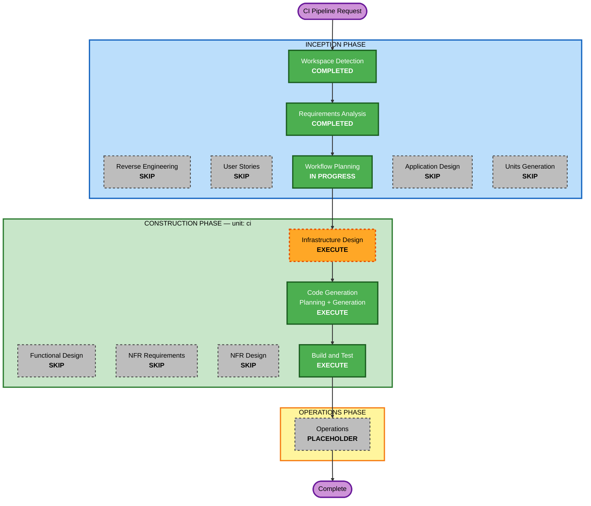

# Execution Plan — Increment r6: CI Pipeline

**Created**: 2026-07-13
**Requirements**: `inception/requirements/requirements.md` §12 (approved 2026-07-13)
**Unit name**: `ci` (single unit — see §Units Generation rationale)

---

## 1. Detailed Analysis Summary

### 1.1 Transformation Scope (Brownfield)

- **Transformation Type**: **Build/verification infrastructure** — not an application change. The running service's behaviour is unchanged except for **three localized defect fixes** that the new blocking gates force into scope (X-2 Slowloris, X-3 integer overflow, X-4 path handling).
- **Primary Changes**:
  1. New `.github/workflows/ci.yml` — the pipeline itself
  2. `.golangci.yml` migrated v1 → v2 schema (**it currently does not load at all**)
  3. `go.mod` / `Dockerfile` toolchain pinned to Go 1.26.5; base images pinned by digest
  4. `Makefile` targets aligned to what CI invokes (pinned tool versions)
  5. Source fixes required to make the blocking gates pass (X-2..X-5)
- **Related Components**: every package is *scanned*, but only 6 source files are *modified*.

### 1.2 Change Impact Assessment

| Area | Impact | Detail |
|---|---|---|
| **User-facing changes** | **No** | No API, no report format, no CLI flag changes. |
| **Structural changes** | **No** | No new components, no new interfaces, no seam changes. depguard confirms the existing architecture is intact (0 violations). |
| **Data model changes** | **No** | Nothing touches BSON, the findings schema, or `data-census.md` sinks. |
| **API changes** | **No** | |
| **NFR impact** | **Yes** | **Security**: X-2 (`ReadHeaderTimeout` missing → Slowloris) is a real availability weakness in shipped code; X-6 (GO-2026-5856) is live in every artifact we currently produce. **Supply chain**: digest/SHA pinning (SECURITY-10/13). **Resiliency**: RESILIENCY-04's CI/CD half is finally satisfied. |
| **Runtime behaviour** | **Minimal but non-zero** | Setting `ReadHeaderTimeout` changes how slow clients are treated. Bumping the Go toolchain changes the stdlib under every binary. Neither is cosmetic — both go through Build&Test. |

### 1.3 Component Relationships

```
Primary (new):        .github/workflows/ci.yml
Config (modified):    .golangci.yml (v1 -> v2)  |  Makefile  |  go.mod  |  Dockerfile
Source (modified):    internal/platform/proxy/authproxy.go     (X-2 ReadHeaderTimeout)
                      cmd/chiller/main.go                      (X-2 ReadHeaderTimeout)
                      internal/findings/store/retry.go         (X-3 int->uint)
                      internal/findings/config/{spec,severity,mapping}.go  (X-4 G304, X-5 errcheck)
                      internal/platform/api/introspect_test.go (X-5 errcheck)
                      internal/scan/fetch/fetch_test.go        (X-5 errcheck)
                      internal/domain/severity_test.go         (X-5 staticcheck)
Scanned, unmodified:  every other package
Untouched:            deploy/k8s/*, deploy/compose/* (no CD in scope)
```

**Change types**: all Minor/Configuration-only. No breaking change to any interface (PR-11 holds trivially — no seam is touched).

### 1.4 Risk Assessment

- **Risk Level**: **Medium** — not because any single change is hard, but because of three things that can bite:

  | Risk | Why it is real | Mitigation |
  |---|---|---|
  | **R-1: Toolchain bump changes the stdlib under everything** | Local Go is **1.26.4**, and we are pinning to **1.26.5**. With `GOTOOLCHAIN=auto` (the default) Go will *download* 1.26.5 on first build. If the environment has `GOTOOLCHAIN=local` or no network, **every build breaks.** This must be verified, not assumed. | Verify the toolchain actually resolves and the full suite passes on 1.26.5 **before** claiming green. This is a Build&Test gate. |
  | **R-2: `ReadHeaderTimeout` is a behaviour change** | A timeout that did not exist now exists. Set it too low and legitimate slow clients are dropped; the auth proxy sits in front of a browser. | Choose the value in Infrastructure Design (not silently in code), and justify it against the existing scan-side timeouts (SR-8). |
  | **R-3: The pipeline cannot be observed running** | **No `git remote` exists.** Nothing can prove the YAML is valid *on GitHub* from here. | Execute every gate **locally** with the exact pinned versions and command lines the workflow uses, and validate the YAML against the Actions schema. Then say plainly what was and was not verified. |

- **Rollback Complexity**: **Easy** — every change is a file; `git revert` restores the prior state. No data migration, no queue drain, no schema change (contrast with the persistence increment, which needed both).
- **Testing Complexity**: **Moderate** — the integration suite needs Docker and takes minutes, and the toolchain bump means the *entire* existing test suite must be re-run, not just the changed files.

---

## 2. Workflow Visualization



### Text alternative (always included, per content-validation.md)

```
INCEPTION
  Workspace Detection ....... COMPLETED
  Reverse Engineering ....... SKIP (artifacts exist; reference-only)
  Requirements Analysis ..... COMPLETED (requirements.md 12, approved)
  User Stories .............. SKIP
  Workflow Planning ......... IN PROGRESS (this document)
  Application Design ........ SKIP
  Units Generation .......... SKIP

CONSTRUCTION (unit: ci)
  Functional Design ......... SKIP
  NFR Requirements .......... SKIP
  NFR Design ................ SKIP
  Infrastructure Design ..... EXECUTE   <- the design work of this increment
  Code Generation ........... EXECUTE   (Part 1 plan, Part 2 generate)
  Build and Test ............ EXECUTE

OPERATIONS
  Operations ................ PLACEHOLDER (production-readiness.md update)
```

---

## 3. Phases to Execute

### INCEPTION PHASE

- [x] Workspace Detection — COMPLETED
- [x] Reverse Engineering — **SKIP**. *Rationale*: Brownfield artifacts already exist and are reference-only (coolant). Nothing about the codebase is unknown; the increment was scoped by directly executing the linters against it.
- [x] Requirements Analysis — COMPLETED (3 question rounds, 0 unresolved ambiguities, 0 blocking findings)
- [ ] User Stories — **SKIP**. *Rationale*: The CLAUDE.md assessment criteria list "Developer tooling or build process improvements" and "Infrastructure changes with no user-facing effects" as explicit SKIP cases. No persona, no user journey, no acceptance criteria that a story would clarify. The three defect fixes (X-2..X-4) are bug fixes with clear, isolated scope. Adding stories here would be ceremony, not clarity.
- [ ] Application Design — **SKIP**. *Rationale*: Zero new components, zero new methods, zero new interfaces. `ReadHeaderTimeout` is a field on an existing `http.Server`, not a design decision about component boundaries.
- [ ] Units Generation — **SKIP**. *Rationale*: This increment is a **single cross-cutting unit** (`ci`). It cannot be decomposed — a pipeline that lints half the repo is not half a pipeline, it is a broken pipeline. The existing 4-unit decomposition (domain/platform/scan/findings) is untouched.

### CONSTRUCTION PHASE — unit `ci`

- [ ] Functional Design — **SKIP**. *Rationale*: No business logic, no data model, no state machine. The defect fixes are one-line changes with no behavioural design to specify beyond the timeout **value**, which belongs in Infrastructure Design (it is a deployment-facing tuning parameter, not business logic).
- [ ] NFR Requirements — **SKIP**. *Rationale*: The tech stack was **selected by the user during Requirements Analysis** (GitHub Actions / cloud runners / pinned tool set — Q1, Q2, Q8, Q11, R1-R4), and the NFRs are already written as CI-NFR-01..06. Re-deriving them would be a no-op. **PBT-09 (framework selection) is unaffected** — no new business logic, no new properties.
- [ ] NFR Design — **SKIP**. *Rationale*: NFR Requirements skipped; no NFR patterns to incorporate into a component design.
- [ ] **Infrastructure Design — EXECUTE**. *Rationale*: **This is where the actual design of this increment lives.** A CI pipeline *is* infrastructure. Decisions that must be made deliberately, not improvised inside YAML:
  - **Job graph**: what runs in parallel vs serially (CI-NFR-03 forbids serializing fast gates behind the 30-minute integration job)
  - **Toolchain resolution strategy** (R-1) — how Go 1.26.5 is obtained on the runner and locally, and what happens under `GOTOOLCHAIN=local`
  - **Digest resolution** — the actual `sha256:` values for `golang:1.26.5` and `distroless/static-debian12:nonroot`, and the policy for refreshing them
  - **Tool version pinning table** — exact versions for golangci-lint, gosec, gitleaks, trivy, syft, govulncheck, and the Actions themselves (by commit SHA)
  - **Caching strategy** — Go module/build cache, without letting a poisoned cache defeat the point of a clean-runner guarantee (CI-NFR-04)
  - **`ReadHeaderTimeout` value** (R-2) — reconciled against the existing SR-8 request deadline
  - **Blocking vs reporting matrix** — the precise mapping from D-6/D-8/D-10/D-11/D-12 onto job/step exit codes
  - **What "green" means when there is no remote** (R-3) — the local verification protocol that substitutes for a real Actions run
- [ ] **Code Generation — EXECUTE (always)**. Part 1 plan → approval → Part 2 generate.
- [ ] **Build and Test — EXECUTE (always)**. *Rationale*: The toolchain bump means the **entire** existing suite (unit + `-race` + integration with real containers) must be re-run, not just the touched files. This increment's whole thesis is that a pipeline which does not run the integration suite is not a pipeline; it would be absurd to ship it on unverified builds.

### OPERATIONS PHASE

- [ ] Operations — **PLACEHOLDER**. Update `operations/production-readiness.md`: close blocking **#6 (Wire CI)**, **#2 (Go ≥1.26.5)**, **#3 (image digests)**; carry forward the "no nightly → quiet-period CVE blind spot" and "branch protection is an operator action" limitations.

---

## 4. Change Sequence

Single unit, but the *order within it* matters — doing it wrong produces a false green:

1. **Toolchain first** (`go.mod` + `Dockerfile`) — everything downstream compiles against it. Verify `go build ./...` and the full test suite still pass on 1.26.5 **before** touching anything else, so that any breakage is attributable.
2. **`.golangci.yml` v1 → v2** — the gate must actually *load* before its findings mean anything.
3. **Fix X-2..X-5** — make the blocking gates passable.
4. **Digest-pin base images** (needs Docker to resolve the digests).
5. **Write `.github/workflows/ci.yml` + align `Makefile`** — last, because it codifies steps 1-4 as gates.
6. **Run every gate locally with the pinned versions** — this is the only verification available (R-3).

---

## 5. Success Criteria

- **Primary Goal**: **A change that breaks `StopScan` must not be able to reach the default branch green.** Concretely: the Valkey `Drain` bug, reintroduced, must turn the pipeline red. Everything else in this increment is in service of that sentence.
- **Key Deliverables**:
  - `.github/workflows/ci.yml` — PR + main push; fast gates parallel to the integration job
  - `.golangci.yml` (v2, loading, 0 findings)
  - `go.mod` + `Dockerfile` on Go 1.26.5 with digest-pinned bases
  - Source fixes X-2..X-5 (including the real Slowloris defect)
  - `Makefile` targets that CI invokes verbatim (no drift between "what CI runs" and "what a developer can run")
- **Quality Gates**:
  - `gofmt` · `go vet` · `make arch-check` · `golangci-lint` · `go build` · `go test -race ./...` · `gitleaks` · `gosec` · **`make test-integration` (real containers)** — all green, all blocking
  - `govulncheck` clean (as a *consequence* of the toolchain bump, though it is non-blocking by decision D-6)
  - `trivy` + coverage + SBOM produced and visible, non-blocking
- **Explicitly NOT claimable**: "the pipeline is green on GitHub." There is no remote. The completion report will state exactly which gates were executed locally with which pinned versions, and that the Actions run itself is unverified.

## 6. Estimated Timeline

- **Stages to execute**: 3 (Infrastructure Design → Code Generation → Build and Test) + Operations placeholder
- **Stages skipped**: 6 (Reverse Engineering, User Stories, Application Design, Units Generation, Functional Design, NFR Requirements, NFR Design — 7 counting NFR Design)
- **Dominant cost**: re-running the full integration suite on the new toolchain (minutes, container-bound), not the authoring.
