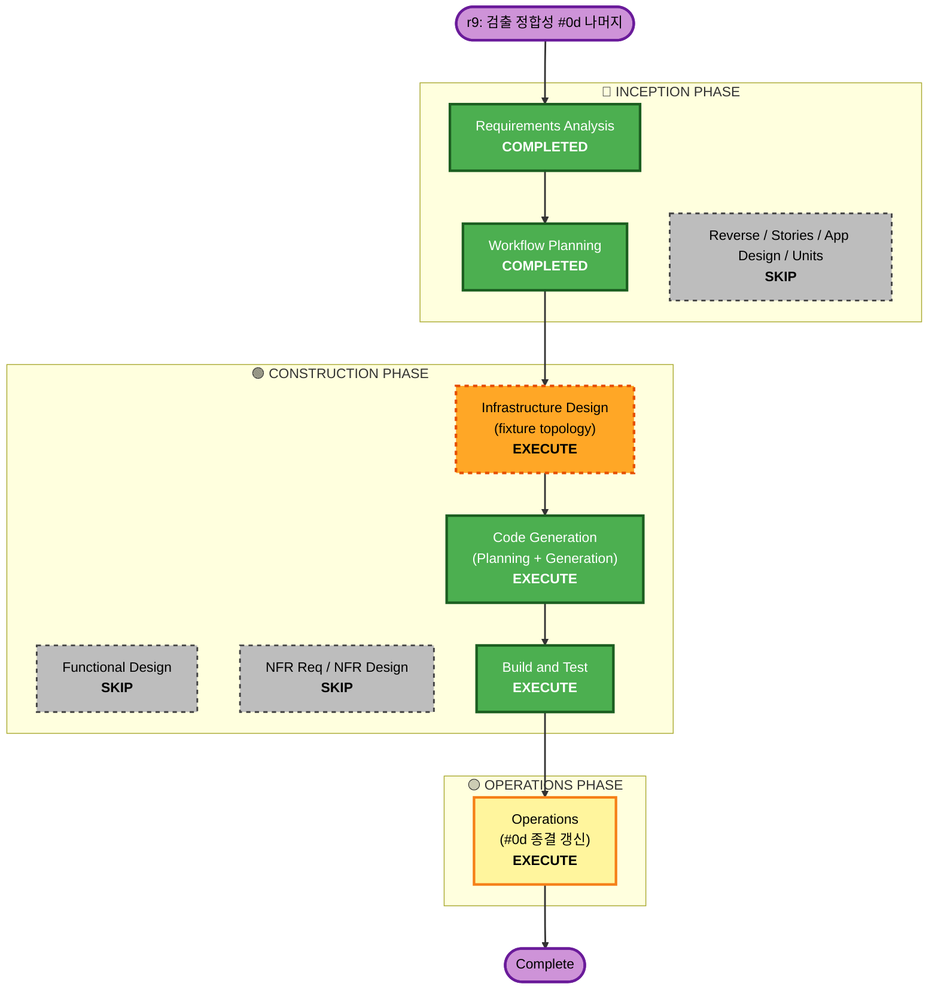

# Execution Plan — Increment r9: 검출 정합성 확대 (testssl/dirhunt/subzy 실측 + 통합 취약 fixture, #0d 나머지)

**Branch**: `feat/probe-parser-fidelity` (현재) · **Requirements**: `requirements-detection-fidelity.md` (approved 2026-07-15)
**Scope**: testssl(badssl 외부)·dirhunt(로컬 autoindex)·subzy(로컬 mock 지문) positive 실측 + `test/fixtures/vuln-target/` 통합 취약 fixture(HTTP probe 5종 + observation dormant 표면) 커밋.

## Analysis

### Transformation Scope (Brownfield)
- **Transformation Type**: Application(파서 검증/교정) + **Test infrastructure 신규**(멀티서비스 취약 fixture). 제품 런타임·배포·인터페이스 **불변**.
- **Primary Changes**:
  - `internal/scan/checking/probe/parsers.go` — testssl/dirhunt/subzy 파서를 실 스키마 대비 검증·필요 시 교정(현재 로직은 존재하나 실 출력 미검증).
  - `internal/scan/checking/probe/testdata/` — 실 출력 골든 추가/갱신(testssl/dirhunt/subzy + humble/httpx/corsy hermetic 재캡처).
  - **신규** `test/fixtures/vuln-target/` — docker-compose 취약 fixture(nginx autoindex·버전배너·permissive CORS·missing-headers·mock takeover 서버 + observation dormant 표면).
  - 통합 테스트(`//go:build integration`) — fixture 기동 대상 positive 단언 확장.

### Change Impact Assessment
- **User-facing changes**: No.
- **Structural changes**: No (제품 아키텍처 불변). 신규는 test/ 스캐폴딩.
- **Data model changes**: No (기존 `domain.Finding` 매핑).
- **API changes**: No (probe adapter 인터페이스 불변).
- **NFR impact**: Yes — security-baseline(취약 fixture 격리·test 전용), resiliency(probe 타임아웃/kill 회귀 없음, badssl 네트워크 실패 정직 처리), PBT(파서 불변식).

### Component Relationships
- **Primary**: `internal/scan/checking/probe` (parsers/testdata/integration).
- **Supporting**: `test/fixtures/vuln-target/` (신규 test 대상), CI(`.github/workflows/ci.yml` probe-integration 잡 — fixture 기동 추가 가능).
- **불변**: 제품 `Dockerfile`, `cmd/chiller`, 배포 매니페스트, 모든 도메인/플랫폼 코드.

### Risk Assessment
- **Risk Level**: **Medium** (r8 Low보다 상향).
  - 신규 멀티서비스 fixture(nginx/mock) 정확성 — subzy 지문·Corsy 반사·autoindex 실 표면.
  - **외부 badssl 네트워크 의존**(testssl) — 통합 flakiness 가능 → tool-failed 정직 처리로 gate 안정화(RES-D2).
  - testssl/dirhunt/subzy 실 JSON 스키마가 현 파서 가정과 다를 수 있음(실 캡처로 해소, 파서 교정 가능성).
- **Rollback Complexity**: Easy (파서/골든/테스트/fixture는 격리된 추가·교정, 제품 코드 불변).
- **Testing Complexity**: Moderate (fixture 기동 + 외부 badssl + 이미지 통합).

## Workflow Visualization

**Text alt**: Requirements(완료)→Workflow Planning(완료)→[Reverse/Stories/App Design/Units/Functional Design/NFR 전부 SKIP]→Infrastructure Design(fixture 토폴로지, 실행)→Code Generation(실행)→Build and Test(실행)→Operations(#0d 종결 갱신).

## Phases

### 🔵 INCEPTION PHASE
- [x] Workspace Detection — COMPLETED (resume)
- [x] Requirements Analysis — COMPLETED (approved)
- [ ] Reverse Eng / User Stories / Application Design / Units Generation — **SKIP**
  - **Rationale**: 신규 제품 컴포넌트·스토리·유닛·서비스 없음. 파서 검증/교정 + test fixture 추가일 뿐.

### 🟢 CONSTRUCTION PHASE
- [ ] Functional Design — **SKIP**
  - **Rationale**: 신규 도메인 엔티티/규칙 없음. 파서는 기존 `domain.Finding` 매핑 재사용.
- [ ] NFR Requirements / NFR Design — **SKIP**
  - **Rationale**: NFR(SEC-D1..3 · RES-D1..2 · PBT-D1)은 이미 requirements에 완전 열거.
- [ ] **Infrastructure Design — EXECUTE** (경량)
  - **Rationale**: 신규 멀티서비스 취약 fixture의 토폴로지(서비스별 취약 표면 매핑) + **security-baseline(blocking)** 격리/test-전용 설계 + 네트워크 경계를 코드 생성 전에 확정. 산출: `construction/scan/infrastructure-design/vuln-fixture-design.md`.
- [ ] **Code Generation — EXECUTE** (Part 1 계획 → Part 2 생성)
  - **Rationale**: fixture 구현(compose/nginx conf/mock 서버) + 실 출력 캡처 → 파서 검증·교정 + 골든 고정 + 유닛/통합 positive 테스트 + 요약.
- [ ] **Build and Test — EXECUTE**
  - **Rationale**: 로컬 gates(build/vet/gofmt/arch-check/race/gosec) + fixture 기동 유닛(골든) + 이미지 통합 positive(확보 대상) + 외부 badssl 정직 처리.

### 🟡 OPERATIONS PHASE
- [ ] **Operations — EXECUTE**: `production-readiness.md` **#0d 종결 갱신**
  - **Rationale**: dirhunt/subzy positive 실측 완료 + testssl(badssl) 실측 반영 → #0d full-DONE 또는 잔여(예: 실 dangling subdomain 미확보 시 subzy positive) 정직 표기.

## Package Change Sequence (Brownfield)
1. `test/fixtures/vuln-target/` — fixture 먼저(실 출력 캡처의 소스).
2. `internal/scan/checking/probe/testdata/` — 캡처 출력을 골든으로 고정.
3. `internal/scan/checking/probe/parsers.go` — 골든 대비 파서 검증·교정.
4. 통합 테스트 + CI 잡 — fixture 기동 positive 단언.

## Estimated Timeline
- **Total Phases (execute)**: 4 (Infra Design · Code Gen · Build&Test · Operations).
- **Duration**: 단일 세션 규모(스코프 응집, 제품 코드 불변).

## Success Criteria
- **Primary Goal**: testssl/dirhunt/subzy 파서가 실 취약 출력에서 올바른 CWE finding 추출(positive 실측) → 검출 정합성 확대.
- **Key Deliverables**:
  - `test/fixtures/vuln-target/` 커밋(HTTP probe 5종 표면 + observation dormant 표면).
  - testssl/dirhunt/subzy 실 골든 + 유닛 positive + 이미지 통합 positive(확보 대상).
  - production-readiness #0d 종결 갱신.
- **Quality Gates**: 로컬 build/vet/gofmt/arch-check/race/gosec(0) green · 이미지 통합 positive green · 정직성 불변식·26 파티션 유지 · 인터페이스 불변 · security-baseline(fixture 격리·test 전용) 준수.
