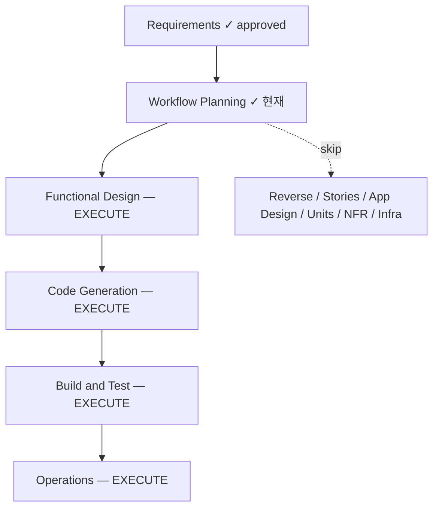

# Execution Plan — Evidence 강화 (r20)

**Stage**: Workflow Planning · **Type**: Brownfield increment · **Risk**: Medium
**Date**: 2026-07-30 · **Branch**: feat/evidence-enrichment (off fix/ps009-capture-group off main)
**Requirements**: `inception/requirements/requirements-evidence.md` (approved)
**Status**: DRAFT — 승인 대기

---

## 1. 요약

`domain.Evidence{Snippets []string}` 를 **구조화된 evidence** 로 교체해 다운스트림 AI(능동 공격 플래너 + 정오탐 체커)가 finding당 (매치 위치 · 룰/가설 · 요청 컨텍스트 · 응답 컨텍스트)를 기계 판독할 수 있게 한다. observation 완전 채움, probe best-effort(날조 금지), 스키마 교체(마이그레이션 없음), `/report` findingDTO 확장.

## 2. Impact / 영향 분석

| 축 | 평가 |
|---|---|
| User-facing | 낮음 — 주 소비자는 기계(AI). 고객 요약 카운트/파티션 불변. |
| **Data model** | **높음 — `domain.Evidence` 계약 교체(핵심 도메인).** 트리거 → Functional Design 필수. |
| API/contract | 중간 — `/report` findingDTO 확장(추가 필드, 하위 요약 불변). |
| **Persistence** | **중간 — crypto.Envelope seal/open + taskstore purge 가 신규 nested 구조 왕복.** AAD 바인딩 불변. |
| NFR/보안 | 중간 — 확장 evidence(헤더/URL/토큰) 경계·redaction·at-rest 암호화(security-baseline blocking). |
| Infra/deploy | 없음 — 신규 backend/배포 변경 없음. 기존 seam 재사용. |

**영향 컴포넌트(기존 유닛 횡단 — 신규 유닛 아님)**: domain(U0) · scan/observation·probe(U2) · findings/normalize·dedup·store(U3) · platform/taskstore·api(U1).

## 3. 실행/생략 결정

### 🟢 EXECUTE (4)
1. **Functional Design** — *근거*: `domain.Evidence` 스키마 교체(데이터 모델 트리거). 신규 구조 정의 + 캡처 스레딩(observation HAREntry→evidence, probe best-effort) + seal/open·purge 왕복 + normalize/dedup 병합 규칙 + findingDTO 형상 + redaction 정책(FR-E10). **가장 중요한 설계 게이트.**
2. **Code Generation** — *근거*: 구현.
3. **Build and Test** — *근거*: 전 게이트(build/vet/gofmt/arch-check/race/gosec) + PBT FULL(경계·멱등·날조없음·seal 왕복 property).
4. **Operations** — *근거*: production-readiness 로그 갱신(r20 evidence 항목).

### 🔵/🟢 SKIP (6)
1. **Reverse Engineering** — *근거*: 레퍼런스(coolant) 이미 존재, 재사용.
2. **User Stories** — *근거*: 신규 사용자 여정 없음. 내부 데이터 계약/기계 소비자용 강화. 요구사항에 소비자 니즈 완전 열거됨.
3. **Application Design** — *근거*: 신규 컴포넌트/서비스 없음. 기존 `Evidence` 타입 + 캡처를 기존 컴포넌트 경계 안에서 수정.
4. **Units Generation** — *근거*: 분해 불필요. 기존 유닛 횡단 단일 변경.
5. **NFR Requirements/Design** — *근거*: NFR(보안 경계·redaction·PBT·resiliency total-capture)이 `requirements-evidence.md` §4 에 완전 열거. 신규 tech stack 없음.
6. **Infrastructure Design** — *근거*: 인프라/배포 변경 없음. 기존 store(Mongo)/taskstore seam 재사용, 신규 backend 없음.

## 4. Risk = Medium — 근거 및 완화

| 리스크 | 완화 |
|---|---|
| 핵심 `domain.Finding` 계약 변경이 전 파이프라인 파급 | 컴파일러가 강제(강타입). FD에서 touch map + 계약 먼저 확정. |
| crypto seal/open 왕복 누락 → 프로덕션 evidence 유실(과거 r17 F1 유형) | PBT: seal→open = 항등. store_mongo·taskstore 테스트 필수. |
| 확장 evidence 가 경계 우회 → 무제한 덤프/민감정보 누출 | FR-E8/E9/E10: 필드별 상한 + at-rest 암호화 + 로그 redact. PBT 경계 property. |
| probe 날조 필드로 "관측 안 한 것 관측한 척" 정직성 퇴행 | FR-E7: 없는 필드 생략(omitempty). PBT: probe evidence 날조 없음 property. |
| 26-파티션/소유권/카운트 회귀 | FD 불변 명시(FR-E13) + Build&Test e2e 카운트 검증. |

**신규 의존성**: 없음 예상(표준 라이브러리로 충분). FD에서 확정.

## 5. 승인 게이트

이 실행 계획(EXECUTE 4 / SKIP 6, Risk=Medium)에 동의하시나요? 사용자는 어느 스테이지든 포함/제외를 오버라이드할 수 있습니다.

- **(A) 승인 & 계속** → Functional Design 착수
- **(B) 변경 요청** → 조정할 스테이지/범위를 알려주시면 반영
