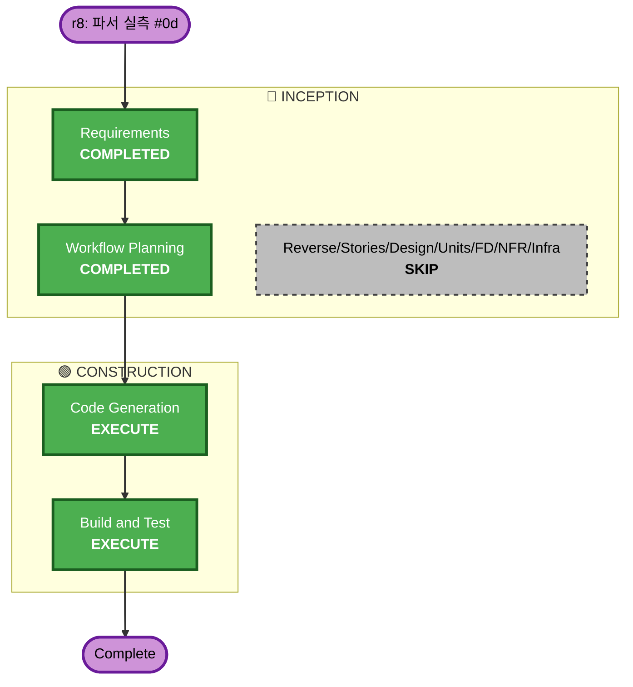

# Execution Plan — Increment r8: Probe 파서 실측 (#0d)

**Branch**: `feat/probe-parser-fidelity` · **Requirements**: `requirements-parser-fidelity.md` (approved)
**Scope**: Juice Shop 실측으로 humble 파서 재작성 + httpx 검증(+가능 시 Corsy); 골든 고정.

## Analysis
- **Transformation**: Application only — `internal/scan/checking/probe/parsers.go` 로직 교정 + `testdata/` 골든 + 테스트. 인터페이스·이미지·배포 불변.
- **Impact**: API/데이터모델/이미지 **불변**. humble 파서만 실질 로직 변경(현 finding 0 → 실 finding). httpx 미세 조정.
- **Risk**: **Low** — 단일 파일·seam 재사용. 롤백 쉬움. 리스크는 Juice Shop 실 스키마 파싱 정확도(실 캡처로 해소).

## Workflow

Text alt: Requirements(완료)→Workflow Planning(완료)→[Reverse/Stories/App Design/Units/Functional Design/NFR/Infra 전부 SKIP]→Code Generation(실행)→Build and Test(실행).

## Phases
### 🔵 INCEPTION
- [x] Requirements Analysis — approved
- [x] Reverse Eng / User Stories / Application Design / Units Generation — **SKIP** (단일 파일 파서 교정, 신규 컴포넌트·스토리·유닛 없음)

### 🟢 CONSTRUCTION
- [ ] Functional Design — **SKIP** (신규 도메인/규칙 없음; 파서=기존 Finding 매핑)
- [ ] NFR Requirements/Design — **SKIP** (NFR-D1..4 이미 requirements에 열거)
- [ ] Infrastructure Design — **SKIP** (이미지/배포 불변; #11 이미지 재사용, Dockerfile 변경 없음)
- [ ] **Code Generation — EXECUTE**: Juice Shop 기동 → 실 출력 캡처 → humble 파서 섹션기반 재작성 + httpx 검증 + 골든 갱신 + 유닛/통합(positive) 테스트 + 요약.
- [ ] **Build and Test — EXECUTE**: 로컬 유닛(골든)+race+gosec + 이미지 내부 통합(Juice Shop positive).

### 🟡 OPERATIONS
- [ ] production-readiness **#0d 부분 종결** (humble/httpx 실측 완료; testssl/dirhunt/subzy 이월 명기).

## Success Criteria
- humble 파서가 Juice Shop 실 출력에서 **실제 finding(≥1)** 산출(현 0 → 수정 증명), httpx 버전 판정 실 출력 검증.
- 골든=실 캡처, 유닛/통합 positive green. 정직성 불변·26 파티션 유지·인터페이스 불변.
- 로컬: build/vet/gofmt/arch-check/race/gosec green.

## Scope
실행 2단계(Code Gen, Build&Test) + Operations 부분종결. 스킵 다수(단일 파일 증분).
