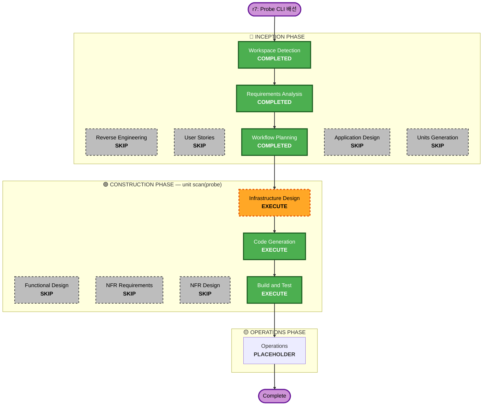

# Execution Plan — Increment r7: Probe CLI 배선

**Branch**: `feat/probe-wiring` · **Date**: 2026-07-14
**Requirements**: `inception/requirements/requirements-probe.md` (approved)
**Scope**: 7개 probe CLI(humble·httpx·testssl.sh·dirhunt·changeme·Corsy·subzy) 실배선 → 12개 tool-failed 항목을 실판정.

---

## 1. Detailed Analysis Summary

### 1.1 Transformation Scope (Brownfield)
- **Transformation Type**: Application + Infrastructure. 앱 = 기존 `probe.Adapter`/`runner` seam에 `argv`+`Parser` 채움(신규 컴포넌트 0). 인프라 = 런타임 이미지 아키텍처 교체(distroless static → 멀티스테이지 툴 이미지) + 7개 바이너리 번들.
- **Primary Changes**: `internal/scan/checking/probe/adapters.go`(7 argv), 툴별 parser 파일, `internal/scan/checking/probe/probe.go`(defaultExec 프로세스그룹 kill), `Dockerfile`(런타임 베이스+번들), 통합 테스트, `test/*_wiring_test.go` 카운트, CI integration 잡.
- **Related Components**: findings coverage 회계(카운트 이동), orchestrator(변경 없음 — 경계 재사용), `configs/mappings/kisa.yaml`(CWE↔PS 이미 존재).

### 1.2 Change Impact Assessment
- **User-facing changes**: 간접 — 리포트가 12개 항목을 무판정에서 실판정으로 바꿈. API 계약 불변.
- **Structural changes**: 예 — 런타임 이미지 베이스 교체(SECURITY-09 수정). 코드 구조는 불변(seam 그대로).
- **Data model changes**: 없음 — `domain.Finding`/`CheckResult` 그대로.
- **API changes**: 없음 — `Adapter`/`Checker` 인터페이스 불변(PR-11). `argv`가 non-nil이 되어 `Wired()`만 뒤집힘.
- **NFR impact**: 예 — 보안(SECURITY-09 수정+하드닝, SECURITY-10 공급망 핀), 리질리언스(서브프로세스 프로세스그룹 kill = 좀비 방지), 테스트(통합 exec 검증).

### 1.3 Component Relationships
- **Primary**: `internal/scan/checking/probe` (adapters + parsers + runner).
- **Infrastructure**: `Dockerfile`(런타임 스테이지, 번들), `deploy/` 매니페스트(read-only FS/tmpfs 반영), `.github/workflows/ci.yml`(integration 잡에 probe 골든).
- **Dependent**: `internal/findings/coverage`(tool-failed→checked 카운트 이동, 회계만), `test/coverage_wiring_test.go`·`platform_e2e_test.go`(기대 카운트).
- **Supporting**: `configs/mappings/kisa.yaml`(불변), `.github/dependabot.yml`(핀 갱신 확장).

### 1.4 Risk Assessment
- **Risk Level**: **Medium** — 코드 변경은 국소적·seam 재사용이라 롤백 쉬움. 리스크는 (a) 이미지 아키텍처 교체(공격면↑, 하드닝으로 완화), (b) 서브프로세스 수명주기(좀비/고아 — 프로세스그룹 kill로 완화), (c) 외부 툴 출력 스키마 변동(핀+골든 픽스처로 완화).
- **Rollback Complexity**: Easy(코드) / Moderate(이미지) — `argv`를 nil로 되돌리면 즉시 tool-failed 정직 상태로 복귀. 이미지는 이전 distroless 태그로 복귀 가능.
- **Testing Complexity**: Moderate — 유닛(exec 경로) + 통합(핀 바이너리 골든, Docker 필요).

---

## 2. Workflow Visualization

### Text alternative (content-validation.md)
INCEPTION: Workspace Detection(완료) → Reverse Engineering(skip) → Requirements Analysis(완료) → User Stories(skip) → Workflow Planning(완료) → Application Design(skip) → Units Generation(skip).
CONSTRUCTION (unit=scan/probe): Functional Design(skip) → NFR Requirements(skip) → NFR Design(skip) → **Infrastructure Design(실행)** → **Code Generation(실행)** → **Build and Test(실행)**.
OPERATIONS: placeholder(production-readiness 갱신 — blocking #0 probe 배선 종료).

---

## 3. Phases to Execute

### 🔵 INCEPTION PHASE
- [x] Workspace Detection — COMPLETED (resume)
- [x] Reverse Engineering — **SKIP**. *근거*: coolant 참조 아티팩트 존재·재사용. 코드베이스에 미지 영역 없음.
- [x] Requirements Analysis — COMPLETED (Q1-6 답변, 모순 0). `requirements-probe.md` 승인.
- [x] User Stories — **SKIP**. *근거*: 순수 인프라/툴링 배선. 새 페르소나·사용자 여정·수용 기준 없음. CLAUDE.md의 "Developer tooling / Infrastructure changes with no user-facing effects" = 명시적 skip. 리포트 항목이 무판정→판정으로 바뀌는 건 기존 스토리(US-007, 부분실패 4-state)가 이미 커버.
- [x] Application Design — **SKIP**. *근거*: 신규 컴포넌트 0, 신규 메서드 0, 인터페이스 변경 0(PR-11). `Adapter`/`runner` seam은 존재; `argv`+`Parser`를 채우는 구현 변경일 뿐.
- [x] Units Generation — **SKIP**. *근거*: 단일 응집 유닛(scan U2의 probe 패키지 + 그 이미지/테스트). 분해 불가·불요. 기존 4유닛 분해(domain/platform/scan/findings) 불변.

### 🟢 CONSTRUCTION PHASE — unit `scan` (probe 패키지)
- [ ] Functional Design — **SKIP**. *근거*: 신규 도메인 엔티티·상태기계·비즈니스 규칙 없음. Parser는 툴 JSON을 기존 `domain.Finding`으로 매핑하는 어댑터 글루 — 툴별 매핑표(어떤 JSON 필드→어떤 CWE/Severity/Evidence)는 **Code Generation 계획 문서**에 선언한다(설계 산출물이 따로 필요할 만큼의 상태/규칙이 없음). *NFR-P6 속성 테스트의 오라클은 이미 requirements에 명시.*
- [ ] NFR Requirements — **SKIP**. *근거*: NFR이 이미 `requirements-probe.md`에 NFR-P1..P6로 완전 열거·정량화됨(서브프로세스 수명주기, 이미지 하드닝, 공급망 핀, exec 검증, 속성 테스트). 재도출 = no-op. (CI 증분과 동일 논리.)
- [ ] NFR Design — **SKIP**. *근거*: NFR 패턴이 이미 확정 — 프로세스그룹 kill(`Setpgid`+음수 PID group kill), read-only FS+tmpfs 작업공간, non-root, digest 핀. 구체 구현은 아래 Infra Design(이미지) + Code Gen(프로세스그룹 kill 코드)에서 실현.
- [ ] **Infrastructure Design — EXECUTE**. *근거*: **이 증분 설계의 핵심.** 즉흥이 아니라 신중히 정해야 할 것: ① 런타임 베이스 선택(python3+bash+openssl 최소 이미지, digest 핀) ② 7개 바이너리 번들 방식(Go=`go install @ver`, Python=`pip ==ver`+requirements 핀, testssl.sh=git tag 체크아웃) ③ 하드닝(non-root, read-only 루트+tmpfs, cap 드롭) ④ SECURITY-09 수정의 명시적 리스크 수용·완화 매핑 ⑤ 배포 매니페스트(deploy/k8s, compose) 반영. 산출물: `construction/scan/infrastructure-design/probe-infrastructure-design.md`(+ 필요 시 compliance-summary).
- [ ] **Code Generation — EXECUTE (always)**. Part 1 계획(툴별 argv+parser 매핑표, 프로세스그룹 kill, 골든 픽스처, 카운트 갱신) → 승인 → Part 2 생성.
- [ ] **Build and Test — EXECUTE (always)**. *근거*: 전체 스위트 재실행(유닛+`-race`+통합). 특히 **통합 exec 검증**(Q4=C)이 이 증분의 수용 조건 — Docker 필요. `TestE2E_UnwiredProbes_…` 기대 카운트 tool-failed 12→0 검증.

### 🟡 OPERATIONS PHASE
- [ ] Operations — **PLACEHOLDER**. `operations/production-readiness.md` 갱신: **blocking #0(probe 배선) 종료**. 이월 한계 갱신(#2 probe stubs 제거), 통합 스위트 Docker 요구·이미지 하드닝 검증 반영.

---

## 4. Change Sequence (단일 유닛 내부 순서)
1. **Infrastructure Design** — 이미지/번들/하드닝 확정(코드가 참조할 실행환경 정의). 
2. **Code Gen Phase A** — `runner` 프로세스그룹 kill(NFR-P1) + `defaultExec` 경로 유닛 테스트(경량 실 바이너리).
3. **Code Gen Phase B** — 툴별 `argv` + JSON `Parser` 7종 + 골든 픽스처.
4. **Code Gen Phase C** — coverage 카운트 이동 + `TestE2E_UnwiredProbes_…`/`coverage_wiring_test.go` 기대 갱신.
5. **Code Gen Phase D** — Dockerfile 번들 + deploy 매니페스트 하드닝 + CI integration 잡.
6. **Build and Test** — 유닛+race+통합(Docker) 전체 green + 실 exec 골든 검증.

## 4b. Interactions with deferred work (§2 금융 auth-proxy · §4 JS capture)
**probe가 실제로 동작할 때 다음 미완 항목들과 얽힌다.** 이 증분은 그 접점을 깨지 않도록 가드레일을 둔다.
(이 항목들은 삭제된 게 아니라 `infra-plan §2/§4`, `production-readiness #4`, `§7` 순서 4·6번에 살아 있음 — 이번에 Backlog에도 재노출.)

- **G1 — 툴별 proxy-env 존중 검증 (필수)**: `ConfigureProxy`가 주입한 `HTTP(S)_PROXY`를 각 툴이 실제로 따르는지 배선 시 확인. 무시하는 툴(예: 전용 `-proxy` 플래그만 쓰는 경우)은 단일 세션 불변식을 **우회**하므로, 그런 툴은 `argv`에서 명시적 프록시 플래그로 강제한다. httpx=`-proxy`, Python(requests 계열)=env 존중, subzy=확인 대상, testssl=DirectOnly(무관).
- **G2 — financial 모드 HTTPS-through-proxy는 §2 대기**: auth-proxy가 아직 CONNECT/MITM 미지원(plain-HTTP absolute-form만). 따라서 이 증분의 통합 테스트는 프록시 경로를 **HTTP(또는 fake 프록시)**로 검증하고, financial+HTTPS probe 커버리지는 **§2 완료 전까지 미도달**로 정직하게 문서화(그 항목을 조용히 clean/실패로 보고하지 않음). 비-financial HTTPS(프록시 없음)와 testssl 직결은 정상 동작.
- **G3 — probe는 작업 탭 풀 T를 소비한다 (코드 확인, 초기 가정 정정)**: 금융권 세션은 **브라우저 종속적**이다 — 인증 상태(쿠키/localStorage)가 storageState로 Chromium 컨텍스트 안에 있다. 따라서 인증 요청을 만드는 유일한 경로는 그 브라우저 컨텍스트로 **재발행**하는 것이고, `authProxy.handle → session.Do → pool.acquire(T)`가 이를 **작업 탭 풀 T로 게이트**한다(`internal/platform/proxy/{authproxy,session}.go` 확인). 즉 financial 모드에서 프록시를 통과하는 **모든 probe 요청이 T의 슬롯을 소비**하며, **네이티브 fetch 워커(`WithProxy`)와 T를 두고 직접 경쟁**한다. probe는 탭 풀과 무관하지 않다. 프록시는 요청마다 두 게이트를 건다: per-host rate budget(`lim.Acquire`, SR-4) **+** 탭 풀 T.
  - **영향**: 대량 요청 probe, 특히 **dirhunt(디렉터리 브루트포스)**·httpx·Corsy가 T를 포화시켜 스캔 워커를 굶길 수 있다. NFR-P2는 "T = work-only(keep-alive만 제외)"를 넘어 **"work = 네이티브 워커 + probe 트래픽이 공유하는 T"**로 정정한다.
  - **§2 결정 사항으로 상정**: T 사이징을 probe 수요까지 포함해 잡을지 / probe에 T의 하위 예산을 분리 배정할지 / 인증 불필요 대상은 probe를 직결(non-proxy)로 뺄지 — 이 증분은 **T가 비경쟁이라고 가정하지 않는다**.
  - **세션 수명**: 긴 host 스캔(dirhunt/testssl은 직결이라 무관)이 세션 수명을 넘기면 **session auto-refresh(§2)** 의존. LoginKeeper가 keep-alive 탭으로 세션 유지가 전제.
  - **이 증분의 범위 결정**: probe는 **직결/비-financial 모드에서 배선·검증**한다(프록시 없이 또는 fake 프록시). **인증 financial probing(T 경쟁 + HTTPS MITM)은 §2로 이월**하되, 위 T-경쟁 제약을 §2 의제에 명시적으로 올린다.
- **G4 — URL-scoped probe 볼륨은 §4 발견에 비례**: PlaywrightDiscoverer(§4)가 동적 JS URL을 추가하면 URL-scoped probe 4종의 호출 수가 늘어난다. 따라서 NFR-P1(프로세스그룹 kill)·NFR-P2(동시성 경계)는 **§4가 만들 더 큰 fan-out에서도 성립**해야 한다(이번 테스트에서 다중 URL fan-out으로 검증). 또한 Chromium provisioning(§2/§4)은 probe 바이너리 번들과 **같은 Dockerfile 멀티스테이지 번들 규율**을 공유 — 이번 probe 번들이 그 패턴을 선점.

**후속 순서 재확인 (사용자 방침)**: probe 배선(이번) → 이후 §2 금융 HTTPS/MITM+LoginKeeper → §4 PlaywrightDiscoverer. 위 G1-G4는 그 순서에서 probe가 후속 작업과 안전하게 합류하도록 하는 계약이다.

## 5. Success Criteria
- **Primary Goal**: 7개 probe 전부 `Wired()==true`; tool-failed 12→0; 26항목 파티션 유지.
- **Key Deliverables**: 7 argv + 7 parser(JSON) + 프로세스그룹 kill + 멀티스테이지 하드닝 이미지 + 유닛&통합 exec 테스트 + 갱신된 회귀 카운트.
- **Quality Gates**: build/vet/gofmt/arch-check green · `go test ./...`+`-race` green · `make test-integration`(Docker, 실 바이너리 골든) green · gosec/govulncheck · 정직성 불변식(`TestUnwiredAdapter_FailsWithErrNotWired`는 배선 안 남은 게 없으면 vacuously 통과, 대신 실 exec 실패→tool-failed 테스트 추가) 유지.
- **Integration Testing**: 각 파서가 핀 바이너리 실출력을 올바른 CWE의 Finding으로 파싱; testssl 직결 / 나머지 proxy.
- **Operational Readiness**: production-readiness #0 종료; 이미지 하드닝(non-root/read-only) 검증.

## 6. Estimated Scope
- **실행 단계**: 3 (Infrastructure Design, Code Generation, Build and Test) + Operations 갱신.
- **스킵 단계**: 6 (Reverse Eng, User Stories, App Design, Units Gen, Functional Design, NFR Req/Design).
