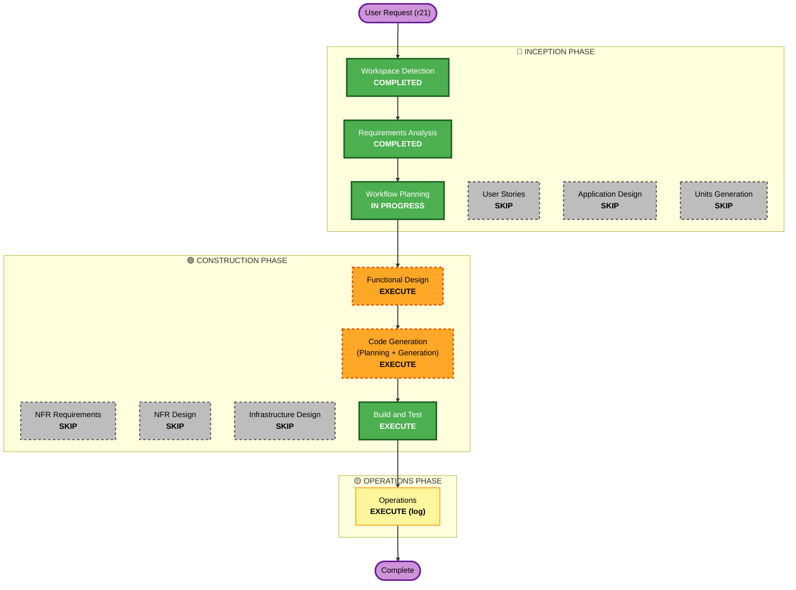

# Execution Plan — recon 노하우 → observation 반영 (r21)

## Detailed Analysis Summary

### Transformation Scope (Brownfield)
- **Transformation Type**: Single-component enhancement (scan/observation 유닛 내부) + config 회계 편집.
- **Primary Changes**: observation 시그니처 3개 강화(PS-009/012/013) + PS-005/006 native 승격 + PII 신규 시그니처 + .DS_Store 편입(PS-010). nuclei-templates pinned 증류 원본(`third_party/`).
- **Related Components**: `internal/scan/checking/observation/`(signatures/wellknown/engine) · `configs/signatures/`(secrets.yaml + 신규 error/stacktrace/pii yaml) · `configs/coverage/kisa.yaml`(delegations 4→2) · `configs/mappings/kisa.yaml`(신규 CWE 엔트리) · `third_party/`(nuclei-templates pinned) · `tools/sigimport`(증류 생성기 확장) · 코퍼스/PBT 테스트.

### Change Impact Assessment
- **User-facing changes**: No — 엔진 내부 시그니처. (리포트에 신규 CWE finding이 나타날 수 있으나 UI 구조 불변; PS-005/006은 이제 judged로 표시)
- **Structural changes**: No — 신규 컴포넌트/서비스 없음. 기존 Signature 인터페이스·레지스트리 확장만.
- **Data model changes**: No — domain.Finding/Evidence 스키마 불변(r20). 신규 CWE 상수만.
- **API changes**: No — Signature 인터페이스·CheckResult·CoverageSpec 계약 불변.
- **NFR impact**: Yes — security(증류 authoring-time·gitleaks allowlist·gosec 0)·resiliency(well-known rate 상속)·PBT FULL.

### Component Relationships
- **Primary**: `internal/scan/checking/observation` (signatures.go, wellknown.go, engine.go, signatures_config.go)
- **Config**: `configs/coverage/kisa.yaml`(delegations), `configs/mappings/kisa.yaml`(weakness map), `configs/signatures/*.yaml`
- **Supporting**: `third_party/nuclei-templates`(pinned), `tools/sigimport`, `Makefile`(signatures/-check targets)
- **Accounting kernel**: `internal/findings/{config,coverage}` — boot totality 체크가 신규 CWE를 검증(코드 변경 불요, config만)
- **변경 없음**: probe(9), 제품 Dockerfile, platform seam, fetch, ingest, report_view 구조.

### Risk Assessment
- **Risk Level**: **Medium** — 파티션 회계 변경(delegations 4→2, observation 13→15, PII 26-밖) 포함이나, boot-totality 체크가 오류를 컴파일/부팅 시점에 잡고(안전망), 26 items 목록·소유권·probe 불변. nuclei-templates 증류는 r16 검증된 방식.
- **Rollback Complexity**: Easy — 단일 브랜치, config+시그니처 편집, `git revert`로 복구. 파티션 회계는 2개 yaml 롤백.
- **Testing Complexity**: Moderate — FP/FN 코퍼스 + PBT FULL + boot-totality/26-파티션 불변 재확인.

## Workflow Visualization

## Phases to Execute

### 🔵 INCEPTION PHASE
- [x] Workspace Detection (COMPLETED — resume, brownfield)
- [x] Reverse Engineering (SKIPPED — artifacts exist)
- [x] Requirements Analysis (COMPLETED — requirements-recon-observation.md 승인)
- [x] User Stories (SKIPPED)
  - **Rationale**: 사용자 대면 기능 아님 — 엔진 내부 시그니처 강화. 페르소나/AC 무가치.
- [x] Workflow Planning (IN PROGRESS)
- [ ] Application Design — **SKIP**
  - **Rationale**: 신규 컴포넌트/서비스 없음. 기존 Signature 인터페이스·레지스트리·CoverageSpec 경계 내 확장. 신규 메서드/서비스 레이어 불필요.
- [ ] Units Generation — **SKIP**
  - **Rationale**: 단일 유닛(scan/observation). 분해 불요.

### 🟢 CONSTRUCTION PHASE
- [ ] Functional Design — **EXECUTE**
  - **Rationale**: 신규 시그니처(PS-005/006/PII)의 판정 규칙·**owning CWE 확정(C-5 핀: PS-005/006 상호구분 CWE, PII CWE-359)**·nuclei-templates 증류 대상 템플릿 셋+pinned SHA·PII evidence 마스킹 정책·백업 매직 판별 규칙·.DS_Store gitExposureSig 편입 설계·파티션 회계 갱신(delegations/mappings) 설계가 필요. requirements의 Open decisions 4건을 여기서 해소.
- [ ] NFR Requirements — **SKIP**
  - **Rationale**: NFR이 requirements-recon-observation.md에 완전 열거(NFR-1..5). 신규 tech stack 없음.
- [ ] NFR Design — **SKIP**
  - **Rationale**: NFR Requirements 스킵 — 신규 NFR 패턴 없음. 기존 하드닝(gitleaks allowlist·rate 게이트·RE2·gosec) 재사용.
- [ ] Infrastructure Design — **SKIP**
  - **Rationale**: 인프라 변경 없음. `third_party/` pinned 원본은 authoring-time(빌드/배포 토폴로지 불변). r16이 동일 증류 취득을 Code Gen 내부에서 처리한 선례.
- [ ] Code Generation — **EXECUTE (ALWAYS)**
  - **Rationale**: 시그니처/config/증류 생성기/코퍼스 구현.
- [ ] Build and Test — **EXECUTE (ALWAYS)**
  - **Rationale**: 전 게이트(build/vet/gofmt/arch-check/race/gosec/secrets/signatures-check) + 코퍼스/PBT + boot-totality/26-파티션 불변 검증.

### 🟡 OPERATIONS PHASE
- [ ] Operations — **EXECUTE (production-readiness r21 증분 로그)**
  - **Rationale**: 검출 커버리지 변화(PS-005/006 native, PII 신규) + 이월 한계 기록.

## Package Change Sequence (single unit)
단일 유닛이라 순차 조정 불요. 내부 순서(Code Gen 계획에서 상술): domain CWE 상수 → mappings/coverage config → 증류 원본+생성기 → 시그니처 → 레지스트리 → well-known → 코퍼스/PBT.

## Estimated Timeline
- **Total Phases (execute)**: 4 (Functional Design · Code Generation · Build and Test · Operations)
- **Skipped**: 5 (Reverse Eng · User Stories · App Design · Units Gen · NFR Req/Design · Infra Design)

## Success Criteria
- **Primary Goal**: recon passive 노하우를 observation에 흡수 — PS-009/012/013 정합성↑ + PS-005/006 native 판정 + PII 검출, 불변 규율 전부 유지.
- **Key Deliverables**: 강화 시그니처 3 + 신규 시그니처 3(PS-005/006/PII) + .DS_Store 편입 + 신규 well-known + nuclei-templates 증류 원본 + FP/FN 코퍼스 + PBT.
- **Quality Gates**: build/vet/gofmt/arch-check/`go test -race`/gosec 0/secrets(full-history) green · `make signatures-check` drift 0 · boot-totality 통과 · 26 items·probe·소유권 불변 재확인.
- **Integration**: end-to-end orchestrator 스캔에서 신규 소유 CWE finding 산출 확인.

## EXECUTE / SKIP 요약
- **EXECUTE (4)**: Functional Design · Code Generation · Build and Test · Operations.
- **SKIP (6)**: Reverse Engineering · User Stories · Application Design · Units Generation · NFR Requirements · NFR Design · Infrastructure Design. (Reverse는 이미 완료 처리)
