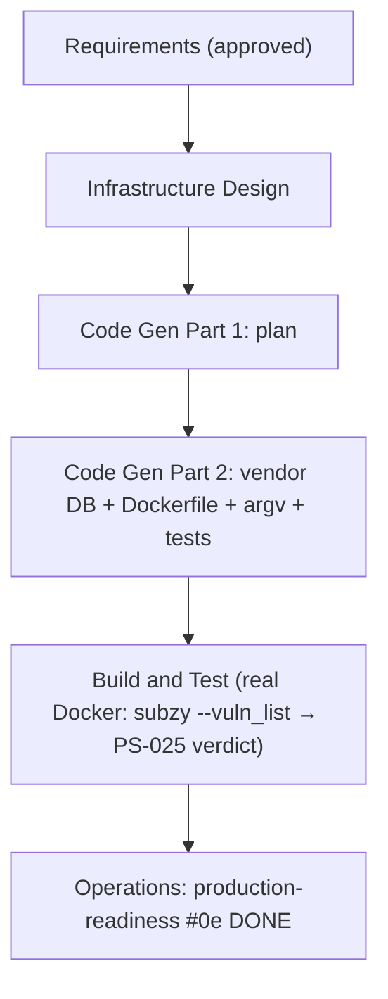

# Execution Plan — subzy fingerprints DB provisioning (#0e, r18)

Branch `feat/subzy-db` (off the post-r17 status-refresh). Single unit = `scan` (probe).
Risk = **Low–Medium**: a vendored data asset + a Dockerfile `COPY` + a one-line `argv`
change. The only real unknown is subzy v1.1.0's exact `--vuln_list` flag/schema — resolved
by the mandatory real-Docker run in Build & Test (with a `$HOME/subzy` cache fallback).

## Stage decisions

| Stage | Decision | Rationale |
|---|---|---|
| Reverse Engineering | **SKIP** | Brownfield; artifacts exist. |
| Requirements Analysis | ✅ **DONE** | `requirements-subzy-db.md` approved (incl. Rationale). |
| User Stories | **SKIP** | Internal runtime-provisioning fix; no new user workflow. |
| Workflow Planning | ✅ this stage | — |
| Application Design | **SKIP** | No new component; existing subzy adapter. |
| Units Generation | **SKIP** | One unit (scan/probe). |
| Functional Design | **SKIP** | No new logic — vendored asset + `argv` + Dockerfile; the `--vuln_list` path is a trivial env-defaulted const. NFRs already enumerated in requirements. |
| NFR Requirements / NFR Design | **SKIP** | Enumerated in requirements (honesty, supply-chain pin). |
| **Infrastructure Design** | ✅ **EXECUTE** | This is an infra increment: the vendored-asset location + pin/SOURCE format, the Dockerfile `COPY` + image path, the `--vuln_list` wiring, and the read-only-rootfs fit. Mirrors the r7 probe Infra Design (IQ-style). |
| **Code Generation** | ✅ **EXECUTE** | Vendor `fingerprints.json` (+LICENSE/SOURCE), Dockerfile `COPY`, `subzyOutArg` `--vuln_list`, gitleaks allowlist for the new third_party asset, tests. |
| **Build and Test** | ✅ **EXECUTE** | **Real Docker run is the load-bearing gate (FR-S4)**: subzy executes with `--vuln_list` (no self-fetch/parse error) and PS-025 yields a real verdict. Plus the local gate suite. |
| Operations | placeholder | production-readiness `#0e → DONE`. |

## Flow

## Scope of change (anticipated) — operator-provisioned (make target + volume)

- `Makefile` — `subzy-db` target: pinned `curl` of `fingerprints.json` → git-ignored
  `deploy/subzy/fingerprints.json`. `.gitignore` — add `deploy/subzy/`.
- `Dockerfile` — `ENV SUBZY_VULN_LIST=/opt/subzy/fingerprints.json` (+ doc comment); NO data baked.
- `deploy/compose/docker-compose.yml` + `deploy/k8s` — document/wire the read-only volume mount.
- `internal/scan/checking/probe/parsers.go` — `subzyOutArg` adds `--vuln_list <path>` (env
  `SUBZY_VULN_LIST`, default the mount path).
- Tests: `subzyOutArg` includes the flag + default; CI probe-integration runs `make subzy-db` +
  points `SUBZY_VULN_LIST` at it, asserting subzy runs without the self-fetch error → PS-025 finding.

## Invariants

probe adapter interface · 26-item partition · CWE ownership · rate/gate/timeout envelope ·
non-root/read-only-rootfs hardening (DB is read-only) · product image size (one small JSON).
