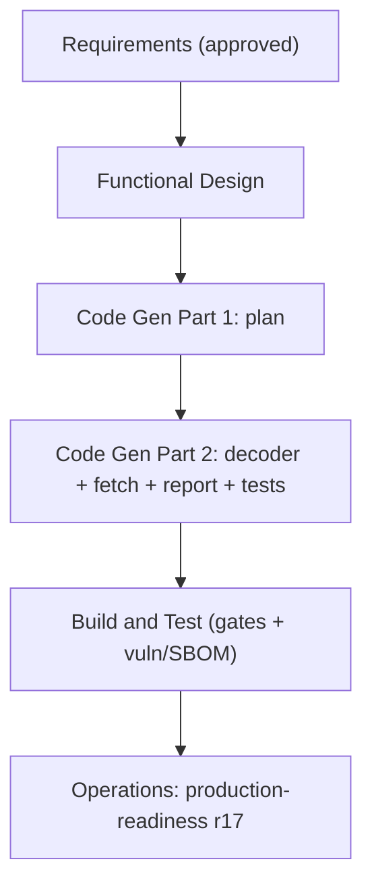

# Execution Plan — P0 Transport Correctness (r17)

Branch `feat/transport-correctness` (off main). Single unit = `scan` (fetch), with a
report-surface touch in `findings`/`platform`. Risk = **Medium** (change on the hot
fetch path + two new decompression deps + a decompression-bomb surface + a report field).

## Stage decisions

| Stage | Decision | Rationale |
|---|---|---|
| Reverse Engineering | **SKIP** | Brownfield; artifacts exist. |
| Requirements Analysis | ✅ **DONE** | `requirements-transport.md` approved. |
| User Stories | **SKIP** | Internal correctness fix; no new user-facing workflow. |
| Workflow Planning | ✅ this stage | — |
| Application Design | **SKIP** | No new component; a decode helper inside the existing fetcher. |
| Units Generation | **SKIP** | One unit (scan). |
| **Functional Design** | ✅ **EXECUTE** | New data-model field (`HAREntry.Truncated`) + how truncation propagates fetch → outcome → report (FR-T4), and the decoder/cap/bomb semantics. NFR-design (bomb bound, total decode) folded in here — no separate NFR stage. |
| NFR Requirements / NFR Design / Infra Design | **SKIP** | NFRs already enumerated in requirements; bomb/total-decode patterns fold into Functional Design; no infra/deploy change (deps via go.mod only). |
| **Code Generation** | ✅ **EXECUTE** | Decoder + fetch wiring + HAREntry field + report surface + tests (incl. PBT). |
| **Build and Test** | ✅ **EXECUTE** | Full gate suite incl. `make vuln`/SBOM for the new deps + `make secrets`. |
| Operations | placeholder | production-readiness r17 log. |

## Flow

## Scope of change (anticipated)

- `internal/scan/fetch/fetch.go` — set `Accept-Encoding`, disable transport auto-decode,
  read compressed body bounded, decode by `Content-Encoding` bounded, set `Truncated`.
- `internal/scan/fetch/decode.go` (new) — codec dispatch (gzip/flate/br/zstd) through a
  bounded (bomb-safe) reader; total function.
- `internal/domain/*.go` — additive `HAREntry.Truncated bool`; a way to carry truncated
  URLs into the report (report field).
- `internal/findings/report` + `internal/platform/orchestrator` — collect truncated URLs
  from outcomes into the report (FR-T4).
- `go.mod` — `andybalholm/brotli`, `klauspost/compress`.
- Tests: decoder PBT (round-trip/cap/bomb/malformed), fetch decode/truncation tests,
  report-surface test.

## Invariants

`Fetcher` interface unchanged (additive field) · 26 partition · CWE ownership ·
rate/gate/timeout envelope · product Dockerfile · platform seams.
