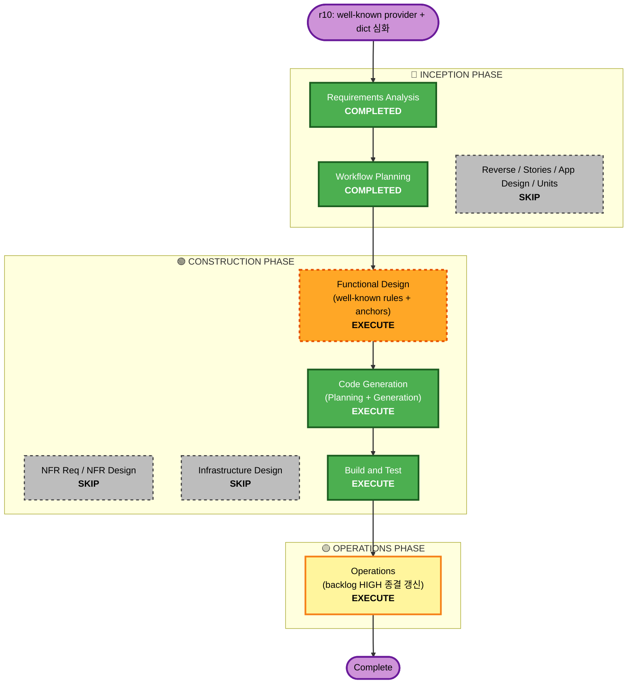

# Execution Plan — r10: Observation well-known-path GET provider + dictionary 심화

**Branch**: (신규, off main) · **Requirements**: `requirements-wellknown.md` (approved 2026-07-16)
**Scope**: fan-out well-known 합성 배선 + 6개 항목(robots/.env/.git/crossdomain/backup/admin) 사전 심화(FN+FP) + r9 fixture 검증.

## Analysis

### Transformation Scope (Brownfield)
- **Type**: Application — scan 유닛(observation + orchestrator fan-out). 신규 제품 컴포넌트(well-known Target 생성기). 배포·이미지·인터페이스(외부 API) 불변.
- **Primary Changes**:
  - **신규** well-known 경로 집합 정의 + host→well-known Target 생성기(`internal/scan/checking/observation/wellknown.go` 또는 `internal/scan/wellknown/`).
  - **수정** `internal/platform/orchestrator/fanout.go` — distinctHosts별 well-known URL-scoped WorkItem 합성(dedup·MaxURLs 제외).
  - **수정** `internal/scan/checking/observation/signatures.go` — 6개 항목 사전/anchor 심화(FN 확장 + FP 축소).
  - **수정/신규** 테스트 + FP/FN 코퍼스 + r9 fixture dormant 표면 활성화 + 통합.
- **불변**: probe·platform seam·domain 인터페이스·26 파티션 소유권·제품 Dockerfile·배포.

### Change Impact
- User-facing: No(리포트에 항목이 실제 판정될 뿐).
- Structural: fan-out에 합성 단계 추가(내부). Data model: No(기존 WorkItem/Finding). API: No.
- NFR: security(approved-host gate 재사용)·resiliency(Fetcher rate/timeout 상속)·PBT(FP/FN 코퍼스).

### Component Relationships
- **Primary**: `internal/scan/checking/observation` (signatures + well-known set) · `internal/platform/orchestrator/fanout.go`.
- **재사용**: `internal/scan/fetch`(Fetcher, gate, rate) · `internal/scan/exec`(URL-scoped 경로 불변) · coverage 회계(불변).
- **검증**: `test/fixtures/vuln-target/`(r9) · `internal/scan/checking/probe`(무관, 불변).

### Risk Assessment
- **Risk Level**: **Medium**.
  - fan-out(orchestrator) 수정 — 합성 WorkItem이 coverage 회계/스케줄에 부작용 없어야(Explore: URL-scoped면 안전, 그래도 회귀 테스트 필수).
  - dictionary 확장 → **신규 FP 위험**(C2=A로 FP 코퍼스가 blocking 완화).
  - MaxURLs 제외·per-host dedup·rate 예산 상호작용.
- **Rollback**: Easy(격리된 추가·시그니처 교정). **Testing**: Moderate(코퍼스 + fixture 통합).

## Workflow Visualization

**Text alt**: Requirements(완료)→Workflow Planning(완료)→[Reverse/Stories/App Design/Units/NFR/Infra SKIP]→Functional Design(well-known 규칙+anchor, 실행)→Code Generation(실행)→Build and Test(실행)→Operations(backlog HIGH 종결 갱신).

## Phases

### 🔵 INCEPTION PHASE
- [x] Workspace Detection — COMPLETED (resume)
- [x] Requirements Analysis — COMPLETED (approved)
- [ ] Reverse Eng / User Stories / Application Design / Units Generation — **SKIP**
  - **Rationale**: 신규 유닛/서비스/외부 API 없음. 단일 유닛(scan) 내부 컴포넌트 추가 + 시그니처 교정.

### 🟢 CONSTRUCTION PHASE
- [ ] **Functional Design — EXECUTE**
  - **Rationale**: 신규 well-known 비즈니스 로직(경로 집합·host별 합성·dedup·MaxURLs 제외 규칙) + 6개 시그니처의 anchor/dictionary 규칙(FN 확장 + **FP 축소**, blocking)을 코딩 전에 확정. 산출: `construction/scan/functional-design/wellknown-*.md`.
- [ ] NFR Requirements / NFR Design — **SKIP** (NFR SEC-W/RES-W/PBT-W 이미 requirements 열거)
- [ ] Infrastructure Design — **SKIP** (신규 인프라 없음; Fetcher/exec 재사용, 경로 목록은 config/code)
- [ ] **Code Generation — EXECUTE** (Part1 계획 → Part2 생성)
  - **Rationale**: well-known 생성기 + fanOut 합성 + 시그니처 심화 + 코퍼스/유닛/통합 테스트 + r9 fixture 활성화.
- [ ] **Build and Test — EXECUTE**
  - **Rationale**: 로컬 gates + FP/FN 코퍼스 + fixture 통합 positive + coverage 26 회귀.

### 🟡 OPERATIONS PHASE
- [ ] **Operations — EXECUTE**: Backlog "🟠 HIGH observation well-known" 종결 갱신 + production-readiness 반영.

## Estimated Timeline
- **Execute stages**: 4 (Functional Design · Code Gen · Build&Test · Operations). 단일 세션~약간 상회(시그니처 심화 + 코퍼스).

## Success Criteria
- **Primary**: PS-008/011/012/022가 well-known GET으로 real finding 전환, PS-010/013 judged. 6개 사전 심화(FN+FP).
- **Deliverables**: well-known 생성기 + fanOut 합성 + 심화 시그니처 + FP/FN 코퍼스 + fixture 활성화 + 요약.
- **Quality Gates**: 로컬 build/vet/gofmt/arch-check/race/gosec(0) green · fixture 통합 positive green · **FP 코퍼스 미발화** · coverage 26 파티션·소유권·인터페이스 불변.
