# Execution Plan — chiller (passive-scanner engine)

**Stage**: INCEPTION → Workflow Planning · **Date**: 2026-07-08
**Context loaded**: `../requirements/requirements.md` (r2) · `../user-stories/stories.md` (29 stories) · `../user-stories/personas.md` (5) · `../reverse-engineering/` (coolant, reference only)

---

## Detailed Analysis Summary

### Project shape
- **Greenfield build** informed by a brownfield **reference** (coolant). Brownfield-only workflow steps (transformation-scope detection §2.1, component-relationship mapping §2.3, multi-module coordination §5) are **N/A** — there is no existing chiller code to transform. coolant is a *pattern source*, not a change target (zero dependency, Q5r1=A / Q1r2=D).

### Change Impact Assessment
| Area | Impact | Note |
|---|---|---|
| **User-facing** | **Yes** | New authenticated scan/status/report API (FR-09) with external uncontrolled consumers (Q3=A); compliance reports consumed by P1/P2. |
| **Structural** | **Yes** | Entirely new architecture — 3 bounded contexts (Scan/Findings/Platform), control/data-plane split, checker plugin seam (NFR-02). |
| **Data model** | **Yes** | New Finding (CWE-keyed, r2), compliance mapping table (FR-14), Scan/Task with FSM + 4-state coverage accounting. |
| **API** | **Yes** | New API is itself the contract; must be versioned for external consumers; framework extension must not break it (NFR-15). |
| **NFR** | **Yes (major)** | Cloud-agnostic/no-AWS (NFR-04), Warm-Standby DR, blue/green + canary, OTel, fault isolation, throttling — production-grade, 3 extensions all blocking. |

### Risk Assessment
- **Risk Level**: **Medium** — greenfield means no production system to break and rollback-in-dev is easy, but scope is **complex** (7 orchestrated tools, unified CWE normalization, task FSM/CAS-resume, production NFRs, cloud-agnostic constraint).
- **Rollback Complexity**: Easy (no live deployment yet).
- **Testing Complexity**: Complex — property-based testing at FULL enforcement, partial-failure semantics, N:M mapping soundness, integration across 3 contexts + 7 external tools.

### Candidate unit decomposition (authoritative decomposition deferred to Units Generation)
The 3 bounded contexts are the natural unit seam and map 1:1 to the Go top-level packages:
- **Unit: Scan** — Ingestion + Safety + Checking (US-001…013)
- **Unit: Findings** — Normalization + Reporting (US-014…023)
- **Unit: Platform** — Orchestration (US-024…029)

Rationale for this being *candidate* only: Units Generation decides whether Checking's 7 tool adapters warrant sub-units, and whether the mapping layer (FR-14) is its own unit. Recorded here as input, pinned there.

---

## Workflow Visualization

```mermaid
flowchart TD
    Start(["User Request"])

    subgraph INCEPTION["🔵 INCEPTION PHASE"]
        WD["Workspace Detection<br/><b>COMPLETED</b>"]
        RE["Reverse Engineering<br/>(reference: coolant)<br/><b>COMPLETED</b>"]
        RA["Requirements Analysis<br/>(r2)<br/><b>COMPLETED</b>"]
        US["User Stories<br/><b>COMPLETED</b>"]
        WP["Workflow Planning<br/><b>IN PROGRESS</b>"]
        AD["Application Design<br/><b>EXECUTE</b>"]
        UG["Units Generation<br/>(Planning + Generation)<br/><b>EXECUTE</b>"]
    end

    subgraph CONSTRUCTION["🟢 CONSTRUCTION PHASE"]
        FD["Functional Design<br/><b>EXECUTE</b>"]
        NFRA["NFR Requirements<br/><b>EXECUTE</b>"]
        NFRD["NFR Design<br/><b>EXECUTE</b>"]
        ID["Infrastructure Design<br/><b>EXECUTE</b>"]
        CG["Code Generation<br/>(Planning + Generation)<br/><b>EXECUTE</b>"]
        BT["Build and Test<br/><b>EXECUTE</b>"]
    end

    subgraph OPERATIONS["🟡 OPERATIONS PHASE"]
        OPS["Operations<br/><b>PLACEHOLDER</b>"]
    end

    Start --> WD
    WD --> RE
    RE --> RA
    RA --> US
    US --> WP
    WP --> AD
    AD --> UG
    UG --> FD
    FD --> NFRA
    NFRA --> NFRD
    NFRD --> ID
    ID --> CG
    CG --> BT
    BT --> OPS
    OPS --> End(["Complete"])

    style WD fill:#4CAF50,stroke:#1B5E20,stroke-width:3px,color:#fff
    style RE fill:#4CAF50,stroke:#1B5E20,stroke-width:3px,color:#fff
    style RA fill:#4CAF50,stroke:#1B5E20,stroke-width:3px,color:#fff
    style US fill:#4CAF50,stroke:#1B5E20,stroke-width:3px,color:#fff
    style WP fill:#4CAF50,stroke:#1B5E20,stroke-width:3px,color:#fff
    style AD fill:#FFA726,stroke:#E65100,stroke-width:3px,stroke-dasharray: 5 5,color:#000
    style UG fill:#FFA726,stroke:#E65100,stroke-width:3px,stroke-dasharray: 5 5,color:#000
    style FD fill:#FFA726,stroke:#E65100,stroke-width:3px,stroke-dasharray: 5 5,color:#000
    style NFRA fill:#FFA726,stroke:#E65100,stroke-width:3px,stroke-dasharray: 5 5,color:#000
    style NFRD fill:#FFA726,stroke:#E65100,stroke-width:3px,stroke-dasharray: 5 5,color:#000
    style ID fill:#FFA726,stroke:#E65100,stroke-width:3px,stroke-dasharray: 5 5,color:#000
    style CG fill:#4CAF50,stroke:#1B5E20,stroke-width:3px,color:#fff
    style BT fill:#4CAF50,stroke:#1B5E20,stroke-width:3px,color:#fff
    style OPS fill:#FFF59D,stroke:#F9A825,stroke-width:2px,color:#000
    style Start fill:#CE93D8,stroke:#6A1B9A,stroke-width:3px,color:#000
    style End fill:#CE93D8,stroke:#6A1B9A,stroke-width:3px,color:#000

    linkStyle default stroke:#333,stroke-width:2px
```

---

## Phases to Execute

### 🔵 INCEPTION PHASE
- [x] Workspace Detection (COMPLETED)
- [x] Reverse Engineering (COMPLETED — reference only, coolant)
- [x] Requirements Analysis (COMPLETED — r2 approved)
- [x] User Stories (COMPLETED — approved)
- [x] Execution Plan (IN PROGRESS)
- [ ] **Application Design — EXECUTE**
  - **Rationale**: An entirely new component graph must be defined — the 3 bounded contexts, the `Checker`/`Analyzer` plugin seam (NFR-02), interface-forced construction + DI (NFR-01), and the control→data-plane dependency direction the stories fixed only in principle. Component methods and business rules (dedup, coverage accounting, CWE→framework projection) need definition. This is the textbook "new components + dependencies need clarification" trigger.
- [ ] **Units Generation — EXECUTE**
  - **Rationale**: The system decomposes into multiple units (candidate: Scan / Findings / Platform, §above). Multiple modules require structured breakdown before the per-unit construction loop. Skipping would force a single monolithic construction pass over a 3-context system.

### 🟢 CONSTRUCTION PHASE *(per-unit loop runs for each unit from Units Generation)*
- [ ] **Functional Design — EXECUTE**
  - **Rationale**: New data models (CWE-keyed Finding, versioned N:M mapping table, Scan/Task FSM) and complex business logic (dedup idempotence, 4-state coverage totality/disjointness, projection-does-not-create-coverage). PBT FULL requires per-unit property tables authored here. The concrete CWE→PS-ID table (constraint C-5) and PS-025 `no-canonical-cwe` decision (A-3) are pinned here.
- [ ] **NFR Requirements — EXECUTE**
  - **Rationale**: Performance (throughput numeric bound deferred here per A-4/NFR-14), security (3 extensions), scalability, and tech-stack selection (self-hostable store, Redis/Valkey queue, OCI registry — the cloud-agnostic choices NFR-04 mandates). Tech stack is not yet fixed.
- [ ] **NFR Design — EXECUTE**
  - **Rationale**: NFR Requirements executes, so its patterns must be designed. This is where the two deferred reconciliations land (A-2): Warm-Standby (NFR-06) vs single-region/multi-AZ (NFR-07), and blue/green (NFR-08) vs canary auto-rollback.
- [ ] **Infrastructure Design — EXECUTE**
  - **Rationale**: Cloud-agnostic deployment must be mapped — containerized version-pinned external tools (C-3, SECURITY-10), K8s/standalone runtime, secrets manager (SECURITY-12), least-privilege identity (SECURITY-06), and alerting/audit (SECURITY-14) — all the SECURITY rules the stories marked "→ Infra Design".
- [ ] **Code Generation — EXECUTE (ALWAYS)**
  - **Rationale**: Implementation planning and code generation for each unit.
- [ ] **Build and Test — EXECUTE (ALWAYS)**
  - **Rationale**: Build, unit/integration/property tests (PBT FULL), and verification across the 3 contexts + 7 external tools.

### 🟡 OPERATIONS PHASE
- [ ] Operations — PLACEHOLDER
  - **Rationale**: Future deployment/monitoring workflows; not part of this build.

**Nothing is skipped.** For a greenfield, comprehensive-depth, production-grade service with three blocking extensions, every conditional stage clears its EXECUTE trigger. Depth *within* each stage still adapts to complexity (per depth-levels).

---

## Estimated Timeline
- **Total stages to execute**: 6 remaining (2 INCEPTION + 4 CONSTRUCTION conditional) + Code Generation + Build and Test, with the CONSTRUCTION per-unit loop repeating for each unit (candidate: 3 units).
- **Duration**: Not time-boxed (AI-DLC is approval-gated per stage, not calendar-driven). Sequence length ≈ 2 + (per-unit stages × unit count) + build/test.

## Success Criteria
- **Primary Goal** (A-4): **coverage-accounting completeness** — every scan classifies all 26 PS-IDs into `found`/`not-applicable`/`delegated`/`tool-failed`. Throughput is a **constraint**, bounded at NFR Requirements.
- **Key Deliverables**: a cloud-agnostic Go service with 3 checkers behind a common seam; CWE-canonical Finding + KISA projection (MVP); task FSM with CAS-resume; unified compliance report + API.
- **Quality Gates**: FR-01…14 all covered (proven in stories §E-6); PBT properties pass at FULL; 3 extensions non-blocking at every stage; zero coolant/Nuclei/AWS runtime dependency.
