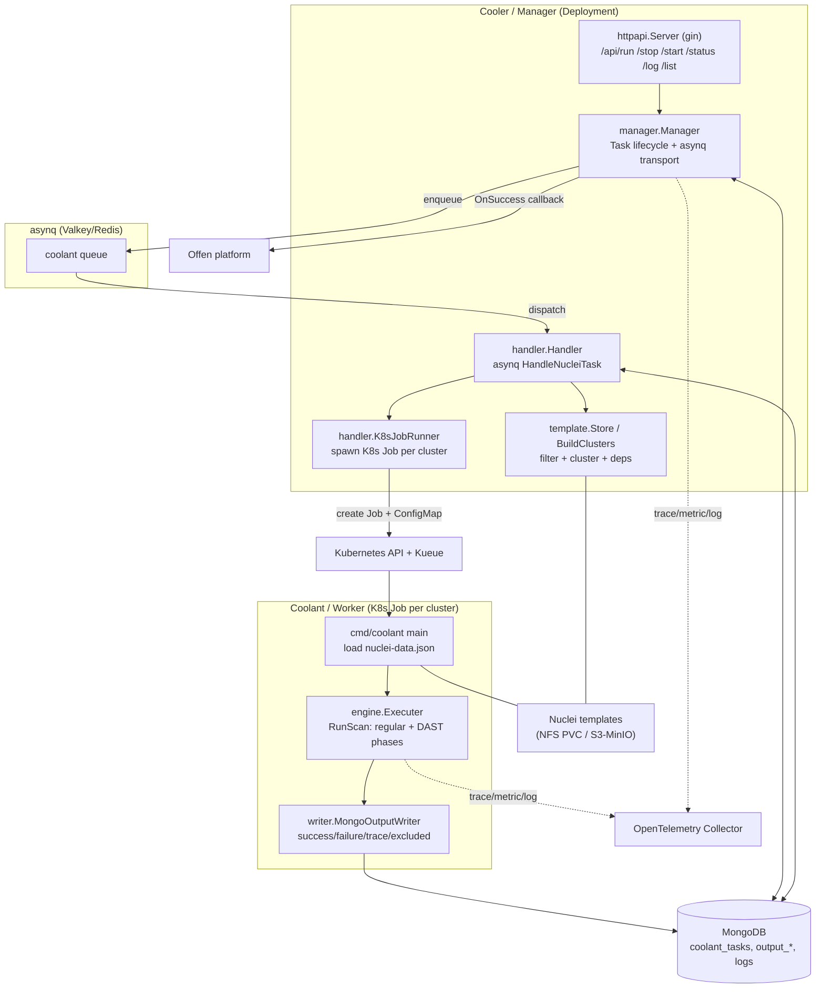
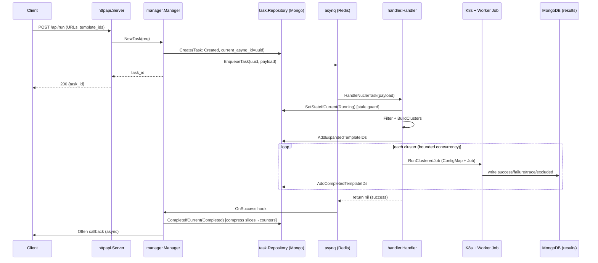

# System Architecture

## System Overview

Coolant is a **two-binary, control-plane / data-plane** system deployed on Kubernetes:

- **Cooler (Manager)** — a long-running Deployment. Serves the REST API (gin), owns the Task state machine in MongoDB, consumes an asynq (Redis/Valkey) queue, and spawns ephemeral Worker Jobs (via the `go-task-manager` K8s executor, gated by Kueue).
- **Coolant (Worker)** — an ephemeral batch Job. Runs one nuclei template cluster against all target URLs and writes findings to MongoDB.

The two communicate **only indirectly**: the Manager encodes a `NucleiJobData` payload into a per-Job ConfigMap (mounted at `/app/nuclei-data.json`); the Worker reads it, runs, and writes results to the shared MongoDB. There is no synchronous RPC between them.

## Architecture Diagram

### Text Alternative
1. Client calls `POST /api/run` → `httpapi.Server` validates → `manager.Manager.NewTask` creates a `coolant_tasks` doc and enqueues an asynq task.
2. asynq dispatches to `handler.Handler.HandleNucleiTask`, which filters templates (`template.Store.Filter`), builds clusters (`BuildClusters`), and spawns one K8s Job per cluster via `K8sJobRunner` (bounded by an errgroup semaphore + Kueue quota).
3. Each Worker Job (`cmd/coolant`) reads its `nuclei-data.json`, runs `engine.Executer.RunScan` (regular phase then DAST phase), and writes results to MongoDB via `MongoOutputWriter`.
4. On handler success, the `OnSuccess` hook marks the Task Completed and fires the Offen callback.
5. Status/progress reads come straight from the `coolant_tasks` document — asynq queue state is never consulted for status.

## Component Descriptions

### httpapi.Server (`internal/manager/httpapi`)
- **Purpose**: REST API surface (gin) with optional bearer-token auth and Swagger docs.
- **Responsibilities**: Request/response binding & validation, auth check, delegates to the `TaskService` interface, formats status/progress/result JSON.
- **Dependencies**: `manager.Manager` (via `TaskService`), `db.Repository` (result + log collections), gin, swaggo, otelgin.
- **Type**: Application

### manager.Manager (`internal/manager`)
- **Purpose**: Task lifecycle owner and asynq transport wrapper.
- **Responsibilities**: NewTask/Start/Stop, asynq enqueue with unique/rotated IDs, OnSuccess/OnFailure hooks, terminal-failure detection, resume leftover computation, Offen callback dispatch, `task.State → state.State` API mapping.
- **Dependencies**: `go-task-manager`, `task.Repository`, `db.Repository`, `handler.Handler`, asynq, google/uuid.
- **Type**: Application

### handler.Handler + K8sJobRunner (`internal/manager/handler`)
- **Purpose**: The asynq worker body — turns one attempt into a set of K8s Jobs.
- **Responsibilities**: Stale-attempt guard (`SetStateIfCurrent`), template filter+cluster, persist expanded/completed template IDs, spawn clustered Jobs concurrently, skip already-completed clusters on resume.
- **Dependencies**: `template.Store`, `go-task-manager/executor`, k8s api, errgroup.
- **Type**: Application

### template subsystem (`internal/manager/template`)
- **Purpose**: nuclei-compatible template resolution and clustering.
- **Responsibilities**: `Store.Filter` (loads both normal + DAST via nuclei SDK dry-run), dependency collection, multi-custom-dir merge (hardlink/copy), `BuildClusters` partitioning by DAST mode + count.
- **Dependencies**: nuclei SDK, gologger.
- **Type**: Application

### engine.Executer (`internal/core/engine`)
- **Purpose**: The worker-side nuclei execution engine.
- **Responsibilities**: `RunScan` two-phase (regular/DAST) execution, `ClassifyTemplateIDs`, `DiagnoseExclusions`, OTel progress ticker, output writer wiring.
- **Dependencies**: nuclei SDK, `writer` package, OTel metrics.
- **Type**: Application

### writer subsystem (`internal/core/writer`)
- **Purpose**: nuclei `output.Writer` + gologger writer implementations targeting MongoDB.
- **Responsibilities**: Buffer results to temp NDJSON files then bulk-insert to `output_success`/`output_failures`; record traces/errors/excluded templates; bridge gologger→slog and slog→Mongo logs.
- **Dependencies**: mongo-driver, nuclei output types.
- **Type**: Application

### domain (`internal/domain/*`)
- **Purpose**: Shared types & persistence contracts.
- **Responsibilities**: `NucleiRequest`/`NucleiJobData` wire schemas, `config` (env-driven), `task` FSM + Mongo repository, `state` API enum, `db` Mongo access.
- **Type**: Model / Application

### opentelemetry (`internal/opentelemetry`)
- **Purpose**: OTel SDK bootstrap (traces, metrics, logs) with collector health check.
- **Type**: Infrastructure/Application

## Data Flow (Submit → Execute → Complete)

## Integration Points
- **External APIs**: Offen platform completion callback (authenticated HTTP POST, target map loaded from `/app/offen/offen-api.json`).
- **Databases**: MongoDB / AWS DocumentDB (`coolant` DB) — tasks, results, failures, traces, errors, excluded, logs. Redis / Valkey — asynq queue backing store.
- **Third-party Services**: Interactsh (OOB interaction server) for nuclei; nuclei template catalog.

## Infrastructure Components
- **Orchestration**: Kubernetes; Worker Jobs gated by **Kueue** LocalQueue/ClusterQueue (CPU/memory/pods nominal quota). **JuiceFS CSI** driver listed as a cluster dependency.
- **Packaging**: Helm chart `infra/coolant` (namespaces: `*-core`, `*-observer`, `*-database`).
- **Images**: `coolant-manager` (Cooler.Dockerfile, bundles kubectl) and `coolant-worker` (Coolant.Dockerfile); pushed to ECR (`ap-northeast-2` default).
- **Templates volume**: shared NFS PVC `coolant-templates` mounted read-only into both Manager and Worker; S3/MinIO (`nuclei-templates` bucket) supported for template distribution.
- **Deployment Model**: Manager Deployment (`replicas: 1`, `Recreate`, `privileged`, `serviceAccountName: manager-sa`) + on-demand Worker Jobs. LoadBalancer Service exposes the REST API on port 8080.
- **Networking**: Worker Job has pod-affinity to co-locate with the Manager node (non-direct-run mode).
