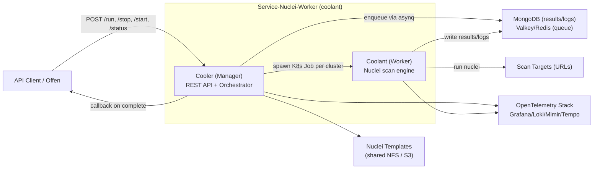

# Business Overview

## Business Context Diagram

### Text Alternative
- API clients (and the Offen platform) submit scan requests to the Manager (Cooler).
- The Manager filters/clusters templates and spawns Kubernetes Jobs (Workers/Coolant), one per template cluster.
- Workers run nuclei against the target URLs and persist results/logs to MongoDB.
- On completion the Manager optionally fires an HTTP callback to Offen.
- Both components emit traces/metrics/logs to an OpenTelemetry backend.

## Business Description

- **Business Description**: Service-Nuclei-Worker (codename **coolant**) is a security-scanning service that orchestrates asynchronous [Nuclei](https://github.com/projectdiscovery/nuclei) vulnerability scans at scale on Kubernetes. A user submits a scan (target URLs + a set of Nuclei template IDs); the system fans the work out across many short-lived worker Jobs, tracks per-template progress, supports pause/resume, and stores findings in MongoDB for later retrieval. It is intended to be driven by an upstream platform ("Offen") that receives a callback when a scan finishes.

- **Business Transactions**:
  1. **Submit Scan** (`POST /api/run`) — validate the request, create a Task, enqueue it, return a `task_id`.
  2. **Query Scan Status & Progress** (`GET /api/task/{id}/status`) — return lifecycle state, per-templateID completion percentage, and (when complete) matched findings.
  3. **List Scans** (`GET /api/task/list`) — enumerate all known task IDs.
  4. **Stop / Pause Scan** (`POST /api/task/{id}/stop`) — cancel the live attempt, transition Task to Paused.
  5. **Start / Resume Scan** (`POST /api/task/{id}/start`) — re-enqueue only the leftover (not-yet-completed) templates.
  6. **Fetch Scan Logs** (`GET /api/task/{id}/log`) — return engine logs captured during the scan.
  7. **Completion Callback** — notify the Offen platform via authenticated HTTP POST when a scan completes.
  8. **Execute Scan (internal)** — a Worker Job downloads its template cluster, runs nuclei in regular then DAST phases, and writes successes/failures/traces/excluded-templates to MongoDB.

- **Business Dictionary**:
  - **Coolant** — the Worker binary (`cmd/coolant`); runs one nuclei scan cluster per K8s Job.
  - **Cooler** — the Manager binary (`cmd/cooler`); serves the REST API and orchestrates workers.
  - **Task** — the user-visible scan entity with a stable UUID identity, decoupled from queue attempts (`internal/domain/task`).
  - **Asynq attempt** — one execution attempt of a Task on the asynq/Redis queue; a Task may span many attempts (retry/resume). Tracked via `current_asynq_id`.
  - **Cluster** — a homogeneous group of templates (all DAST or all non-DAST, capped at `MaxTemplatesPerCluster`) assigned to a single Worker Job.
  - **DAST mode** — nuclei fuzzing mode; a nuclei process runs either fuzzing or non-fuzzing templates, never both, so clustering isolates modes.
  - **Expanded / Completed template IDs** — the resolved full template set vs. the subset whose cluster Jobs finished; drives progress % and resume leftover computation.
  - **Excluded template** — a requested template ID that was not executed (not found or filtered), stored with a diagnostic reason.
  - **Offen callback** — an authenticated HTTP notification to the upstream platform on scan completion.

## Component Level Business Descriptions

### Cooler / Manager (`cmd/cooler`, `internal/manager`)
- **Purpose**: The control plane. Exposes the REST API, owns Task lifecycle, filters & clusters templates, and spawns/monitors Worker Jobs.
- **Responsibilities**: Request validation; Task FSM (Created → Running → Paused/Completed/Failed/Cancelled); asynq queue transport; template filtering/clustering; K8s Job orchestration; resume leftover computation; completion callbacks.

### Coolant / Worker (`cmd/coolant`, `internal/core`)
- **Purpose**: The data plane. A short-lived Job that executes the actual nuclei scan for one template cluster against all target URLs.
- **Responsibilities**: Load its filtered templates; run nuclei in regular + DAST phases; classify/diagnose template exclusions; persist successes, failures, request traces, and logs to MongoDB; emit progress metrics via OpenTelemetry.

### Template subsystem (`internal/manager/template`)
- **Purpose**: nuclei-compatible template filtering, dependency resolution, multi-custom-dir merging, and clustering.
- **Responsibilities**: Use the nuclei SDK to resolve template IDs to files; collect helper/payload dependencies; split matched templates into per-Job clusters by DAST mode and count.

### Persistence & Observability (`internal/domain/db`, `internal/core/writer`, `internal/opentelemetry`)
- **Purpose**: Shared MongoDB access, result/log writers, and OpenTelemetry SDK wiring.
- **Responsibilities**: Mongo connection (with RDS/DocumentDB TLS support); per-collection repositories; buffered NDJSON→Mongo result flushing; OTel traces/metrics/logs export.
