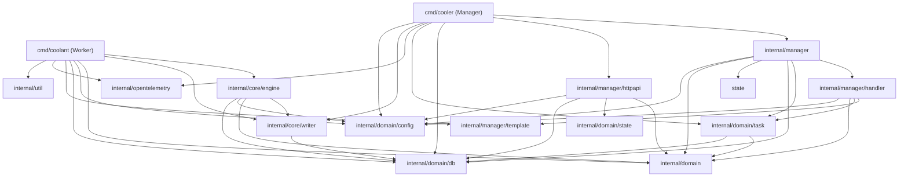

# Dependencies

## Internal Dependencies

### Key internal dependency notes
- **`internal/domain`** is the shared leaf: types (`data.go`), `config`, `task`, `state`, `db`. No package imports upward into `manager`/`core`.
- **`manager` → `handler` → `template`**: control-plane chain. `template` is the only place that touches the nuclei SDK on the manager side.
- **`core/engine` → `core/writer` → `db`**: data-plane chain (worker).
- **Both binaries** depend on `domain/config`, `domain/db`, `opentelemetry`.
- **Interface seams** (for testing): `manager.TaskManager`, `httpapi.TaskService`, `handler.TaskStateRepo`, `handler.JobRunner`, `task.Repository`, `db.Repository`.

## External Dependencies (direct — from go.mod `require`)

| Dependency | Version | Purpose |
|---|---|---|
| projectdiscovery/nuclei/v3 | v3.5.1 | Scan engine + template filtering SDK (core) |
| STONE-GPY/go-task-manager | v0.3.2 | asynq wrapper + K8s Job executor |
| hibiken/asynq | v0.26.0 | Redis/Valkey task queue |
| gin-gonic/gin | v1.11.0 | REST API framework |
| go.mongodb.org/mongo-driver | v1.17.6 | MongoDB / DocumentDB access |
| projectdiscovery/gologger | v1.1.59 | nuclei logging (bridged to slog) |
| swaggo/swag · gin-swagger · files | v1.16.6 · v1.6.1 · v1.0.1 | Swagger docs |
| caarlos0/env | v3.5.0 | Env config binding |
| google/uuid · rs/xid | v1.6.0 · v1.6.0 | Identifiers |
| samber/slog-multi | v1.6.0 | slog fan-out |
| redis/go-redis/v9 | v9.14.1 | Redis client (asynq backing) |
| logrusorgru/aurora | v2.0.3 | Colorizer (nuclei output writer) |
| go.opentelemetry.io/otel (+ exporters/contrib) | v1.40.0 | Traces/metrics/logs |
| golang.org/x/sync | v0.19.0 | errgroup bounded concurrency |
| go.uber.org/multierr | v1.11.0 | Error aggregation |
| gopkg.in/yaml.v2 | v2.4.0 | Template YAML parsing (classifier) |
| gorm.io/gorm · driver/sqlite | v1.30.0 · v1.6.0 | ORM/sqlite (transitive use; drives CGO) |
| k8s.io/api · apimachinery · client-go · utils | v0.35.1 | Kubernetes Jobs/ConfigMaps |
| alicebob/miniredis/v2 | v2.37.0 | Test in-memory Redis |
| stretchr/testify | v1.11.1 | Tests |

- **Vendoring**: all dependencies vendored under `vendor/` (built with `-mod=vendor`). The transitive tree is large (~450 indirect modules) — dominated by nuclei's protocol/plugin ecosystem (aws-sdk-go-v2, go-git, quic-go, docker, chroma, many projectdiscovery libs).
- **License note**: not audited here; the nuclei ecosystem pulls a broad set of MIT/Apache/BSD-licensed libraries. A license scan is recommended before distribution.

## Infrastructure/Runtime Dependencies (not Go modules)
- MongoDB / AWS DocumentDB, Redis / Valkey, MinIO / S3, NFS server (templates), Kubernetes API, Kueue, JuiceFS CSI, OpenTelemetry Collector + Grafana/Loki/Mimir/Tempo, Interactsh server, `kubectl` (bundled in manager image).
