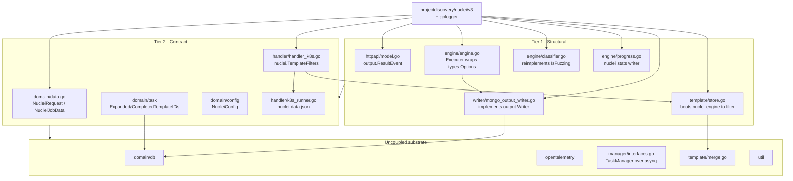

# Nuclei Coupling Analysis

**Analysis Date**: 2026-07-08
**Scope**: Supplement to the 2026-07-08 Reverse Engineering baseline. Answers: *where is the current implementation and architecture coupled to nuclei?*
**Method**: Full non-vendor scan — `grep -rl nuclei`, `grep -rn projectdiscovery --include=*.go`, plus direct read of all 20 coupling sites.

---

## 0. Context — the driving plan is a *sibling orchestrator*, not a change to this repo

> **Correction (2026-07-08).** An earlier draft of this section keyed off `cwe-eval-report.html`, which turned out to be the wrong document. The actual plan is **`augmentation_plan.html`**. The technical body of this analysis (§1–§5) is unaffected — it answers "where is nuclei coupling?" and that remains the correct first question. Only the framing (this section) and the recommendation (§6) are rewritten for the real plan.

**What the plan actually builds.** A **new, separate `passive-scanner` engine** that closes the coverage gap for **KISA compliance — 26 items (PS-001 … PS-026)**: security headers, cookie attributes, version/info disclosure, TLS config, open redirect, etc. These are judged by **observation**, not by active attack, so neither the existing AI-Active-Scanner (injection/payload attacks) nor Nuclei (CVE PoC) covers them.

**The passive-scanner is a multi-tool orchestrator**, composed of three parts:
- **Observation (14 items)** — ZAP *passive only* (no spider, no attack payloads), re-requesting the already-collected target URLs.
- **Single-purpose probes (5 items)** — `testssl.sh`, `Corsy`, `dirhunt`, `changeme`, `subzy`, each wired in via an adapter, each owning one PS item.
- **Engine-native signatures (6 items)** — PS-008/011/012/013/022/023 implemented directly in the new engine as benign-GET response checks.
- PS-014 (HTTP Method) is left to the existing **ASM**.
- The engine **normalizes all three parts to a single PS-ID / severity / evidence report**, and fetches each URL **once**, feeding the one response to both ZAP-passive analysis and the native signatures.

**Why "where is nuclei coupling?" is exactly the right first question.** coolant and the planned passive-scanner are **the same shape of system**:

| | coolant (this repo) | planned passive-scanner |
|---|---|---|
| Input | pre-collected target URLs + template IDs | pre-collected target URLs |
| Work | run **one** security engine (nuclei) | run **seven** tools (ZAP + 5 probes + native) |
| Output | findings normalized to `output.ResultEvent`, to Mongo | findings normalized to PS-ID/severity/evidence |
| Concerns | task lifecycle, progress, resume, fan-out, persistence, OTel | same list — plus per-tool adapters + a normalization hub |

So the coupling map below is the direct input to the build decision: **everything in §3's "uncoupled substrate" is a candidate to share with the passive-scanner; everything in Tier 1/2 is nuclei-specific and does *not* transfer.** Notably, coolant's writer subsystem normalizes *one* engine's output whose native shape *is* the schema; the passive-scanner must normalize *seven heterogeneous* outputs to a *neutral* schema — so the engine-neutral `Finding` type (see §5) is work **both** systems benefit from.

**One overlap point flagged by the plan itself.** The plan notes the 6 engine-native checks *could instead* be Nuclei custom templates (§04 of the plan), since Nuclei is already operated for CVE PoC. That is the one place the passive-scanner's scope brushes against this repo — worth keeping in view for the strategy decision (§6).

**The build decision is therefore not "modify this repo" but "how should a second, structurally-identical orchestrator relate to this one":** copy the patterns into a fresh service, evolve coolant into a multi-engine host, or extract the shared substrate into a library both import. §6 gives a reasoned lean; the open facts are moved to `../requirements/requirements-questions.md`.

---

## 1. Executive summary

nuclei is **not a dependency of this system — it is its domain model.** Coupling is not confined to an adapter layer; it reaches the public HTTP contract, the MongoDB document schema, the unit of progress accounting, and the K8s ConfigMap filenames.

There are **20 non-vendor files** importing `github.com/projectdiscovery/*`, plus 6 infra/Helm files and the `NucleiConfig` env block.

The single most important structural fact:

> **There is no `Scanner` / `Analyzer` interface anywhere in the codebase.**
> `handler.JobRunner` abstracts *how a unit of work is executed* (Kubernetes). It does **not** abstract *what the work is*. `engine.Executer` is a concrete struct instantiated directly by `cmd/coolant/main.go`. The seam a second engine would plug into does not currently exist.

The second most important fact:

> **The unit of progress is a nuclei template ID.**
> `Task.ExpandedTemplateIDs` / `Task.CompletedTemplateIDs`, `Cluster.AllTemplateIDsIn()`, resume-leftover computation, and the `/status` progress percentage are all defined over template IDs. A passive analyzer has no template IDs, so the entire progress, resume, and stop/start correctness machinery has no meaning for it as written.

---

## 2. Coupling map by tier

Tier is assigned by **cost to decouple**, not by import count.

### Tier 1 — Structural (nuclei's types *are* the contract; requires redesign)

| Site | Evidence | Why it is structural |
|---|---|---|
| `internal/manager/httpapi/model.go:3,34,43` | `Result output.ResultEvent` embedded in `TaskStatusResponse` and `TaskReportResponse` | nuclei's Go struct **is the public REST API schema**. Every API consumer (and the generated Swagger, incl. its `cwe-id` field) is bound to nuclei's result shape. Changing engines is a breaking API change. |
| `internal/core/writer/mongo_output_writer.go:135,158,198,290` | implements `output.Writer`; persists `*output.ResultEvent` documents | nuclei's struct **is the MongoDB document schema** for `output_success` / `output_failures`. Historical data is nuclei-shaped. |
| `internal/manager/template/store.go:45-151` | `Filter()` boots a real `nuclei.NewNucleiEngineCtx` **twice** (normal + DAST) in dry-run just to enumerate templates | The manager links the entire nuclei engine — and its ~450-module transitive tree — purely to reuse nuclei's filter semantics. Also mutates the **process-global** `nuclei.DefaultConfig.SetTemplatesDir`, hence the `sync.Mutex` at `store.go:27,46-48`. |
| `internal/core/engine/engine.go:34-40,51-117,212` | `Executer{engineOptions *types.Options}`; `CallEngine` is nuclei SDK option assembly + `ExecuteCallbackWithCtx` | The worker's "engine" is a thin nuclei wrapper with no interface above it. |
| `internal/core/engine/classifier.go:20-51,145-158` | `templateShallow` **reimplements** nuclei's `Template.IsFuzzing()`; `DiagnoseExclusions` uses `disk.NewCatalog`, `severity`, `templates`, `templateTypes` | Coupled to nuclei's **template YAML schema**, not just its API. A nuclei upgrade can silently break this. |
| `internal/core/engine/progress.go` | implements nuclei's stats-writer interface, wired via `nuclei.UseStatsWriter` | Progress metrics are defined by nuclei's `progress.Stats` shape (`domain/data.go:49` documents the copied struct). |

### Tier 2 — Contract (nuclei vocabulary baked into internal wire formats & state)

| Site | Evidence | Notes |
|---|---|---|
| `internal/domain/data.go:7-38` | `NucleiRequest`, `NucleiJobData` (`TemplatePaths`, `TemplateIDs`, `DAST`) | The manager↔worker wire contract. `DAST bool` exists solely because *"a single nuclei process can only run fuzzing OR non-fuzzing templates"* (`data.go:31-33`). |
| `internal/domain/task/task.go:45-47,71-83` | `ExpandedTemplateIDs`, `CompletedTemplateIDs` | **The progress/resume unit.** See §1. |
| `internal/domain/config/config.go:39-45` | `NucleiConfig{ConfigDir, TemplatesDir, InteractshURL, InteractshToken, UserAgent}` | Interactsh (OOB callback server) is a nuclei-specific runtime dependency. |
| `internal/manager/handler/handler_k8s.go:17,118-120` | `nuclei.TemplateFilters{IDs: data.TemplateIDs}` | Handler constructs a nuclei type to hand to `template.Store`. |
| `internal/manager/handler/interfaces.go:44-45` | `JobRunner.RunJob/RunClusteredJob(… domain.NucleiJobData …)` | The *only* engine-adjacent interface is typed on the nuclei payload. |
| `internal/manager/handler/k8s_runner.go:60,76,100,108` | ConfigMap named `nuclei-data-cm--<task>--c<idx>`, key `nuclei-data.json`, mount `/app/nuclei-data.json` | Literals, mirrored in Helm and in `cmd/coolant/main.go:151`. |
| `internal/manager/httpapi/endpoint.go:28-29,135,301,310-313` | `nuclei.TemplateFilters` for request validation; `output.ResultEvent` in responses | Also enforces *"At least one template ID must be specified"* (`endpoint.go:136-139`) — a nuclei-shaped precondition on every task. |
| `internal/manager/template/cluster.go` | pure Go, **zero nuclei imports** — but keyed on `IsDAST` + template IDs | The *algorithm* is reusable; its *domain vocabulary* is not. |
| `internal/manager/template/deps.go:8,18,84` | walks `*templates.Template` internals to find payload/helper files | Depends on nuclei template internals. |
| `internal/manager/manager_k8s.go:24,29,191-197` | `nucleiTemplatesInstaller.TemplateManager{}.UpdateIfOutdated()`; `NucleiTaskType = "coolant:nuclei_task"` | Manager self-updates the nuclei template catalog on boot. |
| `cmd/cooler/main.go:23,128-133` | `nucleiConfig.DefaultConfig.SetConfigDir/SetTemplatesDir/DisableUpdateCheck` | **Process-global nuclei state configured at manager boot**, before any task exists. |
| `cmd/coolant/main.go:166-252` | `types.DefaultOptions()`, `SetTemplatesDir`, `InteractshURL/Token`, `DAST`, `PublicTemplateDisableDownload`, `EnableCodeTemplates`, `TemplateFilters` | The worker's entire bootstrap **is** nuclei option assembly. |

### Tier 3 — Cosmetic (rename-only)

| Site | Evidence |
|---|---|
| `internal/manager/manager_k8s.go:29-30` | `NucleiTaskType = "coolant:nuclei_task"`, `NucleiQueue = "coolant"` |
| `internal/manager/handler/handler_k8s.go:26` | `NucleiTaskPayload` |
| `internal/domain/data.go:41` | `NucleiStatus` |
| `internal/core/writer/{slog_writer,file,mongo_log_writer}.go` | `gologger/levels` bridge (logging only, no engine semantics) |
| Log strings, `cmd/coolant/main.go:44` banner | `"Coolant - Nuclei Scanning Engine"` |

### Infrastructure coupling (non-Go)

| File | Coupling |
|---|---|
| `infra/coolant/templates/core/core-env.yaml:27-29` | `NUCLEI_CONFIG_DIR: /root/.config/nuclei`, `NUCLEI_TEMPLATES_DIR` |
| `infra/coolant/templates/core/worker/coolant.yaml:42,50,64-89,105-108` | `NUCLEI_CONFIG_DIR`, `NUCLEI_DATA` env; `nuclei-config`, `nuclei-ignore`, `nuclei-data` volumes; `nuclei-data.json` subPath |
| `infra/coolant/templates/core/worker/cm-nuclei.yaml`, `cm-nuclei-ignore.yaml` | nuclei config + `.nuclei-ignore` ConfigMaps |
| `infra/coolant/values.yaml:1,86` | shared templates PVC; S3 bucket `nuclei-templates` |
| `go.mod` | `projectdiscovery/nuclei/v3 v3.5.1` → ~450 indirect modules, all vendored (`vendor/`, `-mod=vendor`) |

---

## 3. What is *not* coupled — the reusable substrate

These packages contain **zero** `projectdiscovery` imports and encode no nuclei semantics. They are the part of coolant a second engine could sit on unchanged:

| Package | What it gives you |
|---|---|
| `internal/domain/db` | Mongo/DocumentDB client, `Repository`, aggregation-pipeline updates |
| `internal/domain/state` | API-facing state enum |
| `internal/opentelemetry` | OTel traces/metrics/logs bootstrap |
| `internal/util` | env, IP, base64 |
| `internal/manager/interfaces.go`, `options.go` | `TaskManager` abstraction over asynq; functional options |
| `internal/manager/template/merge.go` | multi-dir merge (hardlink/copy) — generic filesystem work |
| `internal/manager/template/cluster.go` | chunking algorithm (nuclei-flavoured field names only) |

**Partially reusable** (nuclei bleeds in, but the core mechanism is generic):

| Package | Generic core | nuclei bleed |
|---|---|---|
| `internal/domain/task` | Task FSM + `current_asynq_id` compare-and-set concurrency control (rationale: `docs/reports/task-identity-analysis.md`) | progress fields are template-ID sets |
| `internal/manager/manager_k8s.go` | lifecycle, asynq hooks, terminal-failure detection, resume, Offen callback | `updateTemplates()`, `NucleiRequest` payload type |
| `internal/manager/handler/k8s_runner.go` | build K8s Job from template, project ConfigMap, RunAndWait | `nuclei-data.json` literals |
| `internal/manager/httpapi` | gin server, bearer auth, routing, status/progress/list | `output.ResultEvent` responses, template-ID validation |

---

## 4. Dependency direction

### Text alternative
- `projectdiscovery/nuclei/v3` is imported directly by 6 Tier-1 files and 5 Tier-2 files, spanning **both** binaries.
- Tier-1 sites depend on Tier-2 contracts; Tier-2 contracts depend on the uncoupled substrate (`db`, `otel`, `TaskManager`, `merge`, `util`).
- The uncoupled substrate never imports nuclei and never imports upward — it is a clean leaf.
- Consequently: the substrate can host a second engine; every Tier-1 and Tier-2 site is a decision point.

---

## 5. The missing seam

To host a non-nuclei analysis engine, four abstractions must be introduced. None exist today:

1. **`Analyzer` interface** (worker side) — replacing the direct `engine.New(DefaultOptions, database, cfg.API)` construction in `cmd/coolant/main.go:269`. Today `Executer` is concrete.
2. **`WorkUnit` abstraction** (manager side) — replacing `TemplateInfo` / `Cluster` / `nuclei.TemplateFilters`. Today `template.Store.Filter` returns nuclei-derived metadata.
3. **Engine-neutral `Finding` type** — replacing `output.ResultEvent` at *both* the REST boundary (`httpapi/model.go`) and the Mongo boundary (`mongo_output_writer.go`). This is the single largest change, because it is a breaking API change **and** a data-migration.
4. **Engine-neutral progress unit** — replacing template-ID set arithmetic in `domain/task`, `Cluster.AllTemplateIDsIn`, and `computeLeftover` (`manager_k8s.go:297`). Without this, the CAS/resume correctness machinery documented in `docs/reports/task-identity-analysis.md` cannot be reused.

Additionally, two nuclei behaviours are **leaked constraints** that would disappear with a passive analyzer, and their removal simplifies the design:
- the `DAST bool` two-phase split (`engine.RunScan`, `BuildClusters`) exists only because nuclei cannot mix fuzzing modes in one process;
- the process-global `SetTemplatesDir` mutex in `template/store.go` exists only because nuclei's config is a package-level singleton.

---

## 6. Recommendation for the next stage

The decision is **how a second, structurally-identical orchestrator (the passive-scanner) should relate to coolant** — not whether to modify coolant's analysis logic. Three viable strategies, ranked by how well they fit the coupling map above:

**Lean: extract the engine-neutral substrate into a shared Go module** (§3's uncoupled list — `db`, `state`, `otel`, `util`, the `TaskManager` asynq wrapper, the K8s `JobRunner`, and the Task FSM with its progress unit generalized). Both coolant and the passive-scanner import it; neither absorbs the other; each keeps its own engine, its own findings schema, its own deployable. This fits because:
- the substrate has **zero** nuclei coupling (proven in §3), so extraction is mostly moving files + renaming the progress unit (§5.4), not redesign;
- the two engines are **separate stages that never run concurrently** (per the plan), which argues for separate deployables sharing a library, not one multi-engine binary;
- the engine-neutral `Finding` type (§5.3) is needed by the passive-scanner *anyway* (it normalizes 7 heterogeneous tools), so defining it once in the shared module serves both.

This lean is **conditional on the passive-scanner being written in Go** and on wanting separate deployables. If it is not Go, the shared-library option collapses and the honest answer becomes a **container-level contract** (coolant already launches worker images by name via `WORKER_IMAGE_NAME`, `config.go:74`) with no code sharing. These conditions are exactly the open facts in `../requirements/requirements-questions.md`.

Alternatives considered:
- **New repo, copy patterns, no shared code** — simplest to start, but duplicates the `current_asynq_id` CAS/resume correctness (`docs/reports/task-identity-analysis.md`), so both copies must be fixed in lockstep forever. Acceptable only if divergence is expected to be large.
- **In-place multi-engine host** — evolve coolant to run both nuclei and the passive-scanner as pluggable engines in one service. Maximal reuse, but couples two independently-releasable scanners into one deployable and one blast radius, contradicting the plan's "별도 단계" separation. Also front-loads the breaking `Finding`/API change onto coolant's live consumers.

Whichever is chosen, the decoupling work decomposes into independently-shippable units in this order:

1. Engine-neutral `Finding` type (§5.3) — needed first by *both* systems; on the coolant side it is a breaking change + data migration (dual-write / `/api/v2`), so highest risk.
2. Engine-neutral progress unit (§5.4) + `WorkUnit` (§5.2) — touches the CAS/resume correctness core; must preserve the guarantees in `task-identity-analysis.md`.
3. `Analyzer` interface + `Executer` behind it (§5.1) — worker-local, low risk.
4. Substrate extraction / config / ConfigMap / Helm renaming — mechanical.

Do **not** finalize the strategy until the open facts (passive-scanner language, coolant deployment status, API/Mongo consumers, deployable topology) are answered — they flip the lean between "shared Go module" and "container contract".

---

## 7. Verification notes

Every claim above was verified against source at the cited line numbers on 2026-07-08. Counts:
- Non-vendor files importing `projectdiscovery/*`: **20** (17 non-test, 3 test).
- Non-vendor files mentioning "nuclei" in any form: **39** (incl. Helm, docs, go.mod/go.sum).
- Packages with zero nuclei coupling: **7**.
